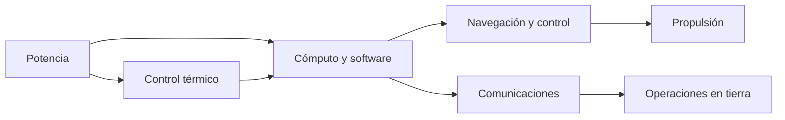
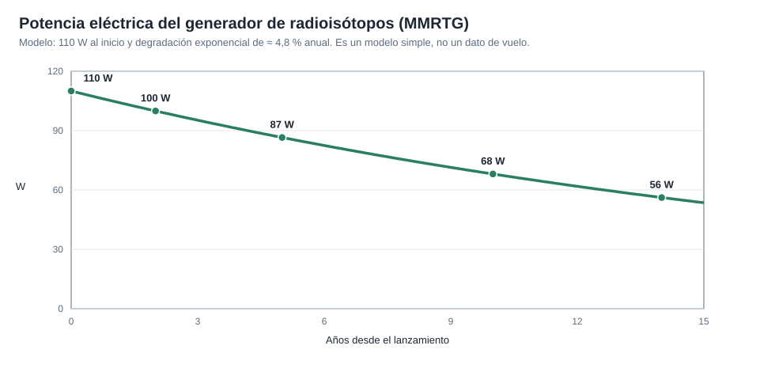

# Capítulo 4 · Subsistemas de la nave

## Por qué existe este capítulo

Una nave no es un objeto: es un conjunto de subsistemas que dependen unos de otros. Si uno no está bien dimensionado, el resto se resiente. Este capítulo recorre los subsistemas del rover y de la nave de crucero, con lo que aporta cada uno y la decisión de diseño más importante de cada caso.

*Descripción textual del diagrama:* la potencia alimenta el cómputo y el control térmico; el cómputo gobierna navegación, propulsión y comunicaciones; la térmica mantiene al cómputo en rango; las comunicaciones llevan todo a operaciones en tierra. Si falla la potencia, falla todo.

## Potencia: energía sin Sol

Marte recibe ≈ 43 % de la luz solar que recibe la Tierra, hay tormentas de polvo que oscurecen el cielo durante semanas y las noches son frías. Mars 2020 usa un **generador termoeléctrico de radioisótopos (MMRTG)**, que convierte el calor del decaimiento de plutonio-238 en electricidad:

- Potencia eléctrica inicial ≈ **110 W** (con ≈ 2.000 W térmicos), con unos 4,8 kg de dióxido de plutonio (⚠ cifras públicas redondeadas).
- Dos baterías de ion de litio dan los picos de consumo.
- La potencia **baja con los años** (≈ 4,8 % anual en nuestro modelo).

*Figura 4.1.* Evolución de la potencia en nuestro modelo. A los 10 años quedan ≈ 62 % de los 110 W iniciales. El diseño debe cerrar el presupuesto con la potencia del **final** de la vida útil, no con la del inicio.

**Decisión clave:** un generador nuclear permite operar de noche, en invierno y en tormentas, pero obliga a un proceso de seguridad especial (capítulo 8) y limita el calor sobrante que debe gestionarse.

## Control térmico

Las temperaturas marcianas oscilan unos 100 °C entre el día y la noche. Los equipos electrónicos solo toleran rangos estrechos. El rover usa un **sistema de bucle de fluido** que lleva el calor sobrante del generador a las zonas que lo necesitan, calentadores eléctricos y aislamiento. En el crucero, radiadores y cubiertas aislantes.

**Pregunta de diseño:** ¿cuánta potencia se gasta solo en mantener caliente la nave? En una misión sin Sol puede ser buena parte del presupuesto.

## Cómputo y software

El rover lleva un computador «de vuelo» **resistente a la radiación** (de potencia modesta comparada con un teléfono) con un respaldo idéntico: si uno falla, el otro toma el mando. El software corre en tiempo real y debe ser **determinista**: la misma entrada, la misma salida, en el mismo tiempo.

Una parte crítica es la **autonomía**: durante la entrada nadie puede intervenir, y en la superficie el retardo de 3 a 22 min obliga a que el rover decida solo cómo evitar un obstáculo. Todo código de vuelo pasa por revisión independiente, pruebas en simulador y en hardware, y reglas de estilo que prohíben construcciones peligrosas.

## Comunicaciones

El rover se comunica de dos formas:

- **Directo a la Tierra**, por antenas de banda X: baja velocidad y poca potencia.
- **A través de satélites en órbita de Marte** (como MRO, MAVEN o la sonda de ExoMars, TGO): el rover les envía datos a alta velocidad cuando pasan por encima, y ellos retransmiten a la Tierra.

En la Tierra, la **Red del Espacio Profundo (DSN)** de la NASA, con estaciones en Goldstone (EE. UU.), Madrid y Canberra, mantiene un contacto casi continuo con las naves. El presupuesto de enlace (potencia transmitida, ganancia de las antenas, distancia, ruido) fija la velocidad de datos y se verifica con la fórmula de Friis; es un cálculo que el estudiante debe repetir.

## Navegación y control

Durante el crucero la nave gira sobre su eje (≈ 2 rpm) para mantenerse estable y apunta con sensores estelares y solares. Las correcciones de trayectoria se calculan en la Tierra, a partir de **medidas de distancia y velocidad por radio**; no hay GPS en el espacio. Al acercarse a Marte, la navegación óptica (fotos de las lunas) afina la posición.

## Propulsión

- **Crucero:** pequeños propulsores de **hidrazina** para las correcciones.
- **Descenso:** ocho motores de empuje variable que frenan y estabilizan.
- **Rover:** no tiene propulsión; se mueve con seis ruedas independientes.

## Instrumentos científicos

El rover lleva siete instrumentos (⚠ verificar nombres y funciones en la fuente): cámaras con zoom (Mastcam-Z), análisis de composición a distancia con láser (SuperCam), mapeo fino de elementos (PIXL), detección de materia orgánica (SHERLOC), radar bajo el suelo (RIMFAX), estación meteorológica (MEDA) y un demostrador de oxígeno (MOXIE). Lleva además el helicóptero **Ingenuity** (≈ 1,8 kg), una demostración tecnológica que superó con creces su plan original.

## Ejercicio del capítulo

1. Con el laboratorio, calcula la potencia disponible al año 5 y al año 10 y haz un presupuesto de energía para un día marciano tipo (cuánto consumen cómputo, calefactores, comunicaciones y movimiento).
2. Calcula un presupuesto de enlace simple (Friis) para tu enlace directo con la Tierra a 2,5 UA: ¿qué velocidad de datos es posible con una antena de 0,5 m y 100 W?
3. Redacta la **decisión clave** de cada subsistema de tu misión en dos frases: qué elegiste, qué descartaste y por qué.

Anterior: [capítulo 3](03-lanzador-masas-y-vehiculo.md) · Siguiente: [capítulo 5 · Entrada, descenso y aterrizaje](05-entrada-descenso-y-aterrizaje.md)
