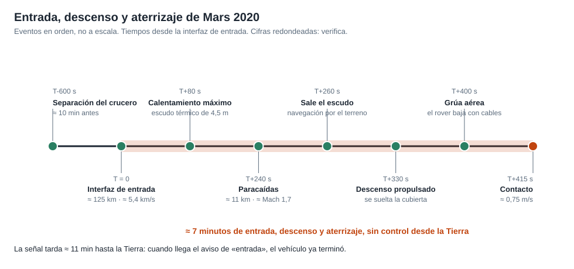

# Capítulo 5 · Entrada, descenso y aterrizaje

## Por qué existe este capítulo

Es la fase que más misiones a Marte han perdido. Durante unos **siete minutos** el vehículo pasa de ≈ 5,4 km/s a ≈ 0,75 m/s, en una atmósfera muy delgada, sin que nadie en la Tierra pueda intervenir. La mitad de los intentos históricos de llegar a Marte han fallado, y muchos fallaron aquí.

## Por qué es tan difícil

- **La atmósfera marciana es muy tenue** (≈ 1 % de la presión terrestre al nivel de referencia): frena lo bastante como para calentar el vehículo, pero no lo bastante para posarlo sin ayuda.
- **El vehículo es pesado** (≈ 3.900 kg al entrar, ⚠ verificar), mucho para un paracaídas.
- **La señal tarda ≈ 11 minutos** en llegar a la Tierra el día del aterrizaje de 2021: cuando se sabe que el vehículo entró, ya terminó.
- **Todo debe ocurrir en orden**, y cada evento depende del anterior (una cadena en serie).

## La secuencia

*Figura 5.1.* Los ocho eventos, en orden (no a escala de tiempo). Tiempos y cifras redondeados: contrástalos con la fuente primaria.

1. **Separación de la etapa de crucero**, unos 10 minutos antes de entrar. Se suelta la parte que dio energía y comunicaciones en el viaje; el vehículo de entrada queda solo.
2. **Interfaz de entrada** (≈ 125 km). Velocidad ≈ 5,4 km/s (nuestro modelo da ≈ 5,6; ver el laboratorio). El **escudo térmico** de 4,5 m de diámetro soporta un calentamiento intenso. El vehículo **maniobra** durante la entrada con pequeños propulsores para reducir el error de puntería.
3. **Calentamiento máximo**, unos 80 s después.
4. **Paracaídas** de ≈ 21,5 m, que se abre a ≈ 11 km de altura y velocidad supersónica (≈ Mach 1,7). Un detalle moderno: el momento de apertura no es fijo, se decide según la posición (**disparo por distancia**) para acercarse al blanco.
5. **Se suelta el escudo.** Los sensores quedan expuestos al suelo; empieza la **navegación relativa al terreno**.
6. **Descenso propulsado.** Se suelta la cubierta con el paracaídas y los motores de la etapa de descenso frenan.
7. **Grúa aérea.** La etapa de descenso se queda suspendida y baja el rover con cables.
8. **Contacto** a ≈ 0,75 m/s. Se cortan los cables y la etapa de descenso se aleja para no caer encima.

## Navegación relativa al terreno (TRN)

El gran avance de Mars 2020 en este campo: una cámara toma fotos del suelo durante el descenso y el computador las **compara con un mapa orbital** guardado a bordo; así sabe dónde está con precisión de decenas de metros, y si el punto previsto es peligroso, **elige otro**. Esto permitió apuntar a Jezero, un sitio de gran interés científico con delta, escarpes y campos de rocas. Los sitios aptos para aterrizar se dibujan como **elipses** de incertidumbre; con TRN la elipse útil se encogió y ya no hacía falta un sitio plano y aburrido.

**Para pensar:** un sistema que decide solo y no puede ser corregido es potente, pero cada línea de su software es un posible fallo. ¿Cómo se prueba algo que no se puede ensayar en Marte?

## Cómo se prueba lo que no se puede ensayar

- **Simulación Monte Carlo:** miles de entradas con incertidumbres en atmósfera, vientos, masa, aerodinámica y errores de sensores; se mide en qué fracción de casos el vehículo aterriza bien.
- **Pruebas parciales reales:** el paracaídas se probó en un túnel de viento gigante y con cohetes sonda en la Tierra; el sistema de visión se probó en helicópteros y cohetes que sobrevolaron terrenos parecidos.
- **Ensayos de extremo a extremo** con el hardware real en banco.
- **Revisión independiente** de cada modelo.

## Qué podría fallar (y cómo se mitiga)

| Evento | Qué podría fallar | Mitigación |
|---|---|---|
| Entrada | Error de puntería o ángulo fuera de rango | Maniobra de entrada y navegación afinada con corrección tardía |
| Escudo térmico | Erosión mayor a la prevista | Material con margen, pruebas en túnel de plasma |
| Paracaídas | Rotura por apertura supersónica | Prueba en túnel de viento, diseño robusto |
| TRN | Mapa o imagen que no coincide | Mapa de referencia de alta calidad, rango de operación probado |
| Descenso propulsado | Motor que no responde | Redundancia parcial; el empuje se reparte entre varios motores |
| Contacto | Rocas o pendiente | TRN, sensores de contacto, rueda y suspensión robustas |

## Ejercicio del capítulo

1. Con el laboratorio, calcula la velocidad de entrada para una v∞ de 2,65 km/s y para 3,2 km/s. ¿Qué pasa con la carga térmica si sube la velocidad?
2. Con la sección 6 del laboratorio, calcula la probabilidad de éxito de tu cadena y propón **dos** mejoras: una que suba la fiabilidad de un evento, y otra que quite un evento de la cadena.
3. Dibuja tu propia elipse de aterrizaje (dimensiones en km) y explica qué peligros contiene.
4. Define los **criterios de "no ir"**: ¿en qué condiciones atmosféricas o de estado de la nave se cancelaría o cambiaría la entrada?

Anterior: [capítulo 4](04-subsistemas.md) · Siguiente: [capítulo 6 · Operaciones y comunicaciones](06-operaciones-y-comunicaciones.md)
