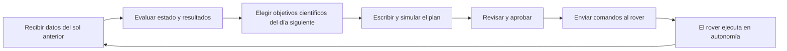

# Capítulo 6 · Operaciones y comunicaciones

## Por qué existe este capítulo

Aterrizar es el comienzo. La misión **vive** en las operaciones: cada día, durante años, hay que decidir qué hace el rover, comprobar que lo hizo y planear lo siguiente. Un diseño excelente mal operado no cumple sus objetivos.

## El retardo de luz manda

La señal viaja a 299.792 km/s. Entre la Tierra y Marte (de 0,37 a 2,67 UA) eso son entre **3 y 22 minutos** en un solo sentido; ida y vuelta, de 6 a 44. El laboratorio (sección 3) lo calcula. Consecuencias:

- **No se puede «conducir» el rover en tiempo real.** Se le envía un plan completo y él lo ejecuta.
- **No se puede reaccionar a una emergencia con la Tierra en el bucle.** El rover debe protegerse solo (modo seguro).
- **La conjunción solar** (cuando el Sol queda entre la Tierra y Marte, cada ≈ 26 meses) interrumpe las comunicaciones unas dos semanas; se planifica en el calendario.

## El ciclo diario de planificación

*Descripción textual del diagrama:* un ciclo que se repite cada «sol» (día marciano, 24 h 39 min 35 s): se reciben los datos, se evalúa, se eligen objetivos, se escribe y simula un plan, se aprueba, se envía y el rover lo ejecuta mientras en la Tierra se descansa para volver a empezar.

**Detalle curioso y real:** el equipo cambia sus horarios para seguir el día marciano en las primeras semanas, de modo que los turnos «rotan» respecto del reloj terrestre. Se llama **tiempo de Marte**. Un reloj que mezcla horas locales, UTC y tiempo de Marte es una fuente de errores: se declara siempre cuál se usa.

## La Red del Espacio Profundo

Tres complejos de antenas gigantes (Goldstone en California, Madrid y Canberra) separados ≈ 120° en longitud para que siempre haya uno viendo al objetivo mientras la Tierra gira. Sus antenas más grandes miden 70 m. Hay una cola de usuarios (decenas de misiones) y el tiempo de antena **se reserva con meses de antelación**: se debe incluir en los requisitos.

## Datos: cuánto se puede mandar

La velocidad de enlace depende de la potencia, de las antenas y de la distancia (capítulo 4). La mayor parte de los datos pasa por **orbitadores de relevo**, que ofrecen decenas o cientos de megabits por segundo en el tramo rover-orbitador, pero solo unos minutos por pasada. El volumen diario es del orden de **cientos de megabits**, lo que obliga a **priorizar**: algunas imágenes bajan en miniatura primero y se decide cuáles pedir completas.

## Autonomía en superficie

Un rover moderno decide solo varias cosas:

- **Navegación autónoma:** elige un camino seguro con sus cámaras y evita obstáculos.
- **Apuntado de instrumentos:** busca objetivos interesantes en las imágenes.
- **Protección:** si detecta una anomalía (batería baja, temperatura fuera de rango), pasa a **modo seguro**: se detiene, apunta la antena a la Tierra y espera instrucciones.

## Operaciones de muestreo

Una parte nueva de esta misión es **recoger y sellar muestras** en tubos para una futura misión de retorno. Es un proceso largo, con dos brazos coordinados y varios chequeos. Cada tubo se registra con sus datos de contexto (dónde, cuándo, qué roca). El destino final de las muestras depende de una misión posterior de recuperación (⚠ verifica el estado actual del programa de retorno de muestras, que ha cambiado).

## Fin de misión

Las misiones no «terminan» un día: se agotan por energía, desgaste o presupuesto. Se define de antemano **cuándo se declara cumplida la misión primaria** y **qué pasa después** (misión extendida, hibernación, abandono). La NASA exige un plan de fin de vida y, en Marte, de **no impacto con zonas especiales**.

## Ejercicio del capítulo

1. Calcula el retardo de luz y el tiempo ida y vuelta en la fecha de tu llegada. ¿Cuántos comandos puede enviar tu rover antes de perder la conexión por la conjunción solar?
2. Diseña **un sol típico**: horarios de comunicación con el orbitador (una pasada de 8 minutos), actividades científicas, recarga y tiempo de reposo.
3. Define tres condiciones que pasan el rover a **modo seguro** y qué debe hacer en cada una.
4. Estima cuánto volumen de datos produce tu carga útil por día y cuánto cabe en tus enlaces. Si sobra, ¿qué descartas?

Anterior: [capítulo 5](05-entrada-descenso-y-aterrizaje.md) · Siguiente: [capítulo 7 · Fiabilidad, fallos y contingencias](07-fiabilidad-fallos-y-contingencias.md)
