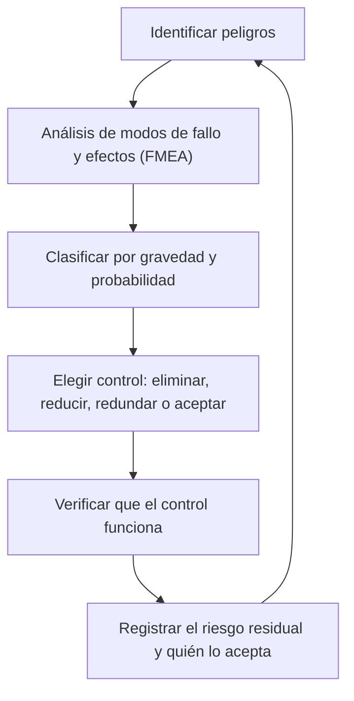

# Capítulo 7 · Fiabilidad, fallos y contingencias

## Por qué existe este capítulo

«A prueba de fallos» no existe en el espacio. Lo que existe es una **gestión disciplinada del riesgo**: saber qué puede fallar, cuánto importa, qué se hace para que no ocurra y qué se hace si ocurre. Este capítulo reúne ese método y lo ilustra con fallos reales.

## Los fallos reales que enseñan

Marte es el destino con el historial más duro: aproximadamente la mitad de las misiones enviadas han fallado. Algunos casos, contados con el cuidado de no atribuir lo que no se sabe (⚠ contrasta los detalles en los informes oficiales de cada investigación):

| Misión | Año | Qué ocurrió | Lección |
|---|---|---|---|
| Mars Climate Orbiter | 1999 | Se perdió al llegar: un equipo entregó datos de impulso en **unidades inglesas** y otro los usó como si fueran métricas. La trayectoria quedó demasiado baja. | **Unidades y sistema de referencia** declarados en cada interfaz; verificación cruzada independiente |
| Mars Polar Lander | 1999 | Se perdió en el descenso; la investigación apuntó a que una señal espuria de contacto apagó los motores demasiado pronto | Probar **cada modo de fallo** de sensores; software que no confíe en una sola señal |
| Schiaparelli (ExoMars) | 2016 | Un dato de actitud saturado hizo que el computador creyera estar más bajo de lo real, soltó el paracaídas antes de tiempo y se estrelló | **Margen en los rangos de los sensores**; pruebas con datos fuera de lo esperado |
| Beagle 2 | 2003 | Llegó a Marte pero no se pudo comunicar | **Una pieza sin respaldo** puede perder toda una misión; observación de la superficie posterior mostró que se había posado |
| Spirit y Opportunity | 2004 | Misiones planeadas por 90 soles que duraron años | La **robustez con margen** da vida extendida; la ingeniería conservadora no es cobardía |

## Método: del peligro al control

*Descripción textual del diagrama:* un ciclo continuo: se identifican peligros, se analizan sus modos de fallo, se priorizan, se elige un control (en este orden de preferencia: eliminar el peligro, reducirlo, duplicar la función o aceptarlo), se verifica y se documenta el riesgo que queda y quién lo asume. Vuelve a empezar al cambiar el diseño.

### 1. Análisis de modos de fallo y efectos (FMEA)

Una tabla donde cada fila es una pieza o función: **qué puede fallar, por qué, qué efecto tiene en la misión, cómo se detecta y qué se hace**. Se acompaña de un **árbol de fallas** para los eventos catastróficos (por ejemplo, «el rover no aterriza»), que descompone el evento en combinaciones de fallos más simples.

### 2. Gravedad y probabilidad

Se pone cada riesgo en una **matriz 5 × 5** de probabilidad frente a gravedad. Los riesgos «rojos» (graves y probables) **no se aceptan**: se rediseñan. Los «amarillos» se mitigan y se vigilan. Los «verdes» se registran.

### 3. Redundancia: cuándo ayuda y cuándo no

- **Redundancia activa o en espera:** dos computadores, uno de respaldo.
- **Redundancia de función:** ocho motores de descenso, de modo que la falla de uno no impide frenar.
- **Diversidad:** que el respaldo use un diseño o software distinto, para no copiar el mismo error.

**Cuidado con la ilusión.** La redundancia añade masa, complejidad y modos de fallo nuevos (el conmutador que cambia al respaldo también puede fallar). Y no protege contra un **error común**: dos computadores idénticos con el mismo defecto de software fallan juntos. El laboratorio (sección 6) lo muestra: una cadena de seis eventos con 99 % cada uno ya baja a ≈ 95 % de éxito global.

### 4. Márgenes

Un margen es la diferencia entre lo que el diseño **puede** y lo que la misión **necesita**. Se llevan márgenes de masa, de potencia, de Δv, de enlace, de temperatura y de calendario. Un principio: **ningún margen se gasta sin registro y aprobación**.

### 5. Verificación y validación

- **Verificación:** ¿construimos bien lo que especificamos? (pruebas, análisis, inspección, demostración)
- **Validación:** ¿lo que especificamos era lo correcto?

El camino típico: pruebas de **componentes**, de **subsistemas**, de **sistema completo**, con ciclos de vacío térmico, vibración y acústica que imitan el lanzamiento. «Prueba como vuelas, vuela como pruebas» es la regla.

### 6. Revisiones formales

Una misión pasa por hitos de revisión con un comité independiente: de **requisitos** (SRR), de **diseño preliminar** (PDR), de **diseño crítico** (CDR) y de **preparación para el lanzamiento** (FRR/ORR). No se pasa al siguiente hito sin cerrar las observaciones del anterior.

## Contingencias: qué hacer si falla algo en vuelo

Un plan de contingencias contesta de antemano estas preguntas:

- ¿Qué fallos son **recuperables** y con qué procedimiento?
- ¿Qué **modo seguro** adopta la nave y cómo se sale de él?
- ¿Quién decide, con qué información y en cuánto tiempo?
- ¿Cuál es el **plan B de la ventana**? Si el lanzamiento se retrasa, ¿hay margen dentro de la ventana, o se pierde la oportunidad por dos años?

## Ejercicio del capítulo

1. Haz un **FMEA** de diez filas para el descenso de tu misión. Para cada fila: modo de fallo, efecto, detección, mitigación, gravedad (1-5), probabilidad (1-5).
2. Construye un **árbol de fallas** de «el rover no aterriza» hasta cuatro niveles.
3. Con el laboratorio, mejora una probabilidad de evento y calcula cómo cambia el éxito global. ¿Qué pasa con el costo y la masa?
4. Elige **tres márgenes** de tu misión y define quién puede autorizar gastarlos.
5. Escribe tu **lista de «no ir»** para la cuenta regresiva del lanzamiento.

Anterior: [capítulo 6](06-operaciones-y-comunicaciones.md) · Siguiente: [capítulo 8 · Protección planetaria y seguridad](08-proteccion-planetaria-y-seguridad.md)
