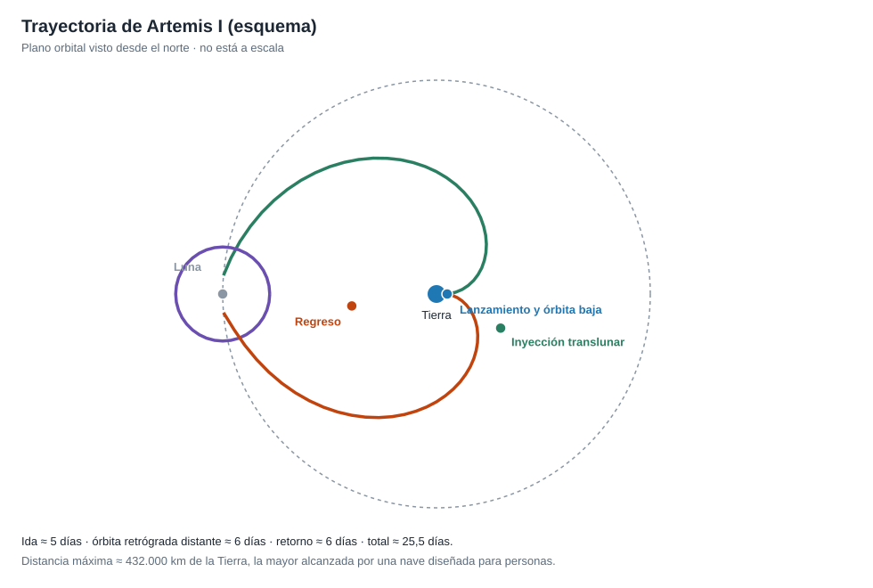

# Capítulo 2 · Ventana y trayectoria

## Por qué existe este capítulo

Ir a la Luna no es como ir a Marte: está cerca (384.400 km, ≈ 1,3 s luz), así que el viaje dura **días**, no meses, y se repite **cada mes**. Pero la geometría tiene sus condiciones, y la trayectoria de Artemis I tiene una forma poco intuitiva: no se queda en órbita *alrededor* de la Luna sino en una **órbita retrógrada distante**.

## La ruta, en cuatro tramos

*Figura 2.1.* Esquema (no a escala). Generado por [`figuras_T02.py`](figuras_T02.py).

1. **Inyección translunar (TLI).** Desde una órbita baja de unos 200 km, un impulso de ≈ 3,1 km/s (laboratorio, sección 2) lleva la nave a una elipse que llega hasta la Luna. Tiempo de ida: ≈ 5 días.
2. **Sobrevuelo lunar de ida** a ≈ 130 km de la superficie: la gravedad de la Luna curva la trayectoria y la dirige hacia la órbita distante.
3. **Órbita retrógrada distante (DRO).** Una órbita grande, a decenas de miles de kilómetros de la Luna, que gira en sentido contrario al de la Luna alrededor de la Tierra. Es **muy estable**: casi no gasta combustible en mantenerse. Se estuvo allí varios días.
4. **Salida y retorno.** Una quema saca la nave de la DRO; un segundo sobrevuelo lunar con propulsión la manda a la Tierra; la reentrada se hace a ≈ 11 km/s.

### Por qué una DRO

- **Estabilidad:** ideal para probar sistemas durante días sin gastar combustible.
- **Distancia:** permite alcanzar la mayor separación de la Tierra (≈ 432.000 km, récord para una nave diseñada para personas).
- **Prueba de vida útil:** ejerce el vehículo durante una misión larga, como una futura tripulada.

La contrapartida: **un abortaje en la DRO no es inmediato**; hay que prever cómo volver si algo falla.

## La ventana mensual

La Luna orbita la Tierra en ≈ 27,3 días, de modo que las oportunidades se repiten **cada mes**. Las condiciones que fijan los días útiles:

- **Posición relativa:** la nave debe llegar a donde estará la Luna.
- **Eclipses:** limitar el tiempo en la sombra de la Tierra protege la energía solar y el equilibrio térmico (en esta misión, límite de unas 90 minutos continuos ⚠ verificar).
- **Zona de recuperación:** el amerizaje debe caer en un lugar accesible a los barcos, con buen tiempo y luz.
- **Periodo de lanzamiento:** se define un conjunto de días y horas aptos.

### Aplazamientos reales

Artemis I **no despegó en el primer intento**: hubo aplazamientos por un problema de enfriamiento en un motor (29 de agosto), una fuga de hidrógeno (3 de septiembre) y huracanes (Ian y Nicole) que obligaron a volver al edificio de ensamblaje. Despegó el 16 de noviembre. Esto es normal y se planifica: **el calendario debe tener holgura y un plan para cada día de la ventana**.

## Cálculos con el laboratorio

Ejecuta `python laboratorio_T02.py` y comprueba:

| Magnitud | Valor | Unidad |
|---|---|---|
| Velocidad orbital de la Luna | 1,02 | km/s |
| Delta-v de inyección translunar (desde 200 km) | 3,13 | km/s |
| Tiempo de ida (media elipse) | ≈ 5 | días |
| Velocidad de escape local a 130 km de la Luna | 2,29 | km/s |

El modelo de dos cuerpos **no incluye la gravedad de la Luna durante el viaje**: es un problema de tres cuerpos. Por eso el tiempo real y la trayectoria final se calculan con herramientas numéricas, y el modelo simple solo sirve para el orden de magnitud.

## Sistema de referencia y tiempo

Geocéntrico inercial para la inyección y la reentrada; selenocéntrico para el sobrevuelo; **fechas en UTC**. Mezclar sistemas es una fuente clásica de errores (capítulo 7 de T01).

## Ejercicio del capítulo

1. Calcula la inyección translunar para un perigeo a 300 km. ¿Cuánto cambia el delta-v?
2. Explica con tus palabras por qué una DRO es estable y qué se gana a cambio de la distancia.
3. Diseña un **periodo de lanzamiento** de una semana: condiciones, días útiles y plan si se pierde un día.
4. Escribe el plan de **qué ocurre si la quema de salida de la DRO no se ejecuta**.

Anterior: [capítulo 1](01-objetivo-y-requisitos.md) · Siguiente: [capítulo 3](03-lanzador-masas-y-vehiculo.md)
