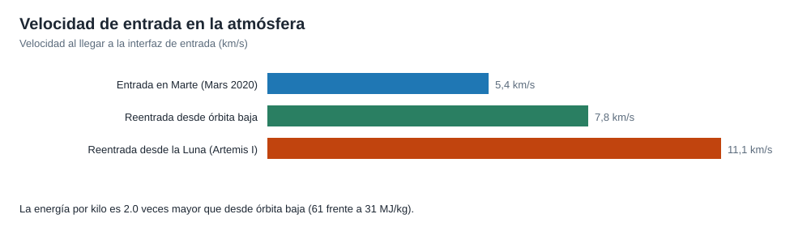

# Capítulo 5 · Reentrada y amerizaje

## Por qué existe este capítulo

Es la fase que justifica el vuelo. Volver de la Luna significa entrar en la atmósfera a **≈ 11 km/s** (≈ 40.000 km/h), unas **2,8 veces** el flujo de calor de una reentrada desde órbita baja. Ninguna cápsula moderna lo había hecho, y de su resultado depende que alguien pueda ir dentro.

*Figura 5.1.* La energía específica de la entrada desde la Luna (≈ 61 MJ/kg) es el doble de la de una reentrada desde órbita baja (≈ 31 MJ/kg).

## La física en una línea

Toda esa energía cinética debe convertirse en calor y disiparse en la atmósfera. El laboratorio (sección 4) lo calcula: desde la Luna la velocidad de entrada es √(2μ/r) ≈ 11,07 km/s a 122 km de altitud; desde una órbita baja, ≈ 7,83 km/s. El flujo de calor crece aproximadamente con la **tercera potencia** de la velocidad.

## El escudo térmico

Un escudo de unos **5 m de diámetro** con un material ablativo (**Avcoat**): se va quemando de forma controlada y se lleva el calor consigo. Soporta temperaturas del orden de **2.800 °C** (⚠ verificar), cerca de la mitad de la temperatura de la superficie del Sol.

**Lo que se aprendió en el vuelo (⚠ contrasta con los informes oficiales):** al inspeccionarlo, el material se había desprendido de forma más irregular de lo previsto en algunas zonas. No hubo daño a la estructura de la cápsula, pero el hallazgo llevó a estudiar la causa y a ajustar la trayectoria de reentrada de los siguientes vuelos. Es un ejemplo de lo que significa que **un vuelo de prueba cumpla su objetivo**: encontrar el problema antes de poner personas dentro.

## Reentrada con rebote

En lugar de bajar de golpe, la cápsula entra, **sube un poco y vuelve a entrar** (reentrada con rebote o «skip»):

- **Reduce la carga** de deceleración sobre la tripulación (hasta ≈ 4 g en la fase principal).
- **Controla el punto de amerizaje** con precisión de pocos kilómetros.
- **Reparte el calor** en dos etapas.

La cápsula tiene **sustentación** (su centro de masa está desplazado y se inclina para generar fuerza hacia arriba) y los propulsores controlan su orientación. Cada decisión de guiado la toma un computador, porque la entrada dura unos minutos y no hay tiempo de intervenir.

## Paracaídas y amerizaje

11 paracaídas en tres etapas (⚠ cifras): los de apertura reducen la velocidad, los **tres principales** la bajan hasta ≈ 30 km/h al llegar al agua. La cápsula amerizó frente a Baja California; la **recuperación** la hizo un buque anfibio de la Armada de Estados Unidos con apoyo de buzos, helicópteros y un equipo de la NASA.

## Qué podría fallar

| Evento | Qué podría fallar | Mitigación |
|---|---|---|
| Entrada | Ángulo incorrecto (demasiado plano rebota al espacio, demasiado empinado quema) | Corredor de entrada estrecho; correcciones de trayectoria antes de la entrada |
| Escudo | Erosión mayor de lo previsto | Margen de espesor, pruebas en túneles de plasma, inspección tras el vuelo |
| Rebote | Fallo de guiado | Computadores redundantes y modos degradados |
| Paracaídas | Fallo de apertura | Redundancia: la cápsula puede aterrizar con uno menos |
| Amerizaje | Condiciones del mar | Zona y ventana elegidas con meteorología |

## Ejercicio del capítulo

1. Con el laboratorio, calcula la razón de energía para entrada desde la Luna y desde órbita baja. ¿Y desde un asteroide con v∞ = 5 km/s?
2. Explica, con un esquema, por qué un ángulo demasiado plano puede hacer rebotar la nave.
3. Diseña el criterio de **aceptación del escudo** tras un vuelo de prueba: ¿qué mediciones haces y qué resultado te haría repetir la prueba?
4. Calcula la carga de deceleración si se reduce de 11 a 0 km/s en 600 s de forma uniforme.

Anterior: [capítulo 4](04-subsistemas.md) · Siguiente: [capítulo 6](06-operaciones-y-comunicaciones.md)
