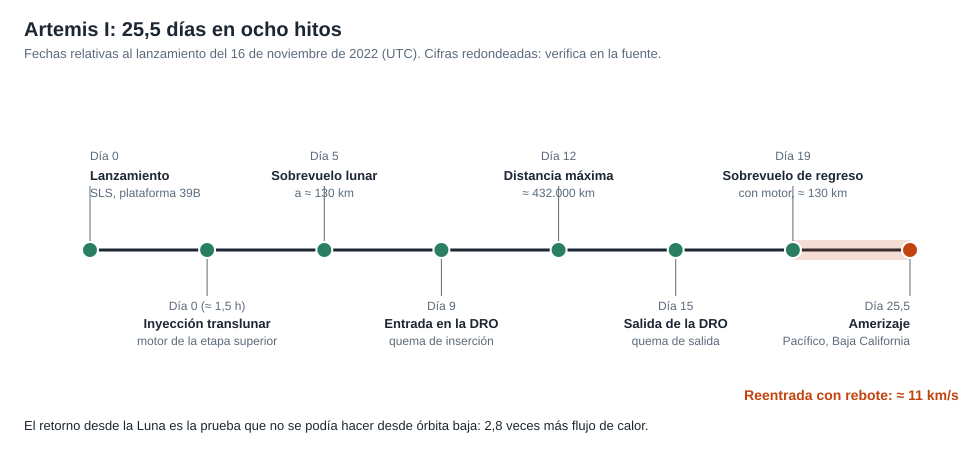

# Capítulo 6 · Operaciones y comunicaciones

## Por qué existe este capítulo

Una misión a la Luna se opera «casi en directo»: la señal tarda poco más de un segundo. Eso permite un modelo de operaciones distinto al de Marte, más parecido al de una misión tripulada de órbita baja, con decisiones tomadas en tiempo real por un equipo en tierra.

*Figura 6.1.* Los ocho hitos de la misión, en días desde el lanzamiento.

## Dos centros de control

- **Centro de lanzamiento (Kennedy):** cuenta atrás, carga de propelentes y las decisiones de «ir o no ir» hasta el despegue.
- **Centro de control de misión (Johnson, Houston):** desde que la torre se libera hasta el amerizaje. Un equipo de controladores por sistema, con un director de vuelo que decide.

La separación es habitual y debe tener una **transferencia de mando** clara y ensayada.

## «Ir / no ir»

Antes de cada evento crítico, cada controlador responde «ir» o «no ir» y el director decide. Las reglas de vuelo, escritas **antes** de la misión, evitan discutir criterios bajo presión: «si ocurre X, hacemos Y». Un ejemplo: la cuenta atrás tiene **puntos de espera** donde se puede detener y reanudar.

## Enlaces

- **Cercanos a la Tierra:** satélites de relevo y estaciones de seguimiento.
- **Espacio profundo:** la Red del Espacio Profundo (DSN) cuando la nave se aleja.
- **Retardo:** 1,28 s a la distancia media de la Luna, 1,44 s a la máxima. El laboratorio (sección 6) lo calcula.
- **Datos:** se transmiten imágenes y telemetría; parte del volumen se descarga después, cuando hay mejor visibilidad.

La Luna ofrece un caso particular: en su **lado oculto** no hay línea de vista con la Tierra; al pasar tras ella se pierde la señal por unos minutos. Se planifica de antemano y las maniobras en esa zona se ejecutan **de forma autónoma**.

## Operaciones en la órbita distante

Durante varios días la nave opera en la DRO, con **ciclos de verificación**: encender, comprobar y apagar sistemas, tomar datos y enviar. Una misión tripulada ocupará ese tiempo con la tripulación; en Artemis I, con los maniquíes y los sensores.

## Operaciones de recuperación

Una parte que se suele subestimar: planificar la **recuperación** (zona de amerizaje, buques, helicópteros, procedimientos de seguridad con combustibles de la cápsula, seguimiento por radio y baliza). Fue una operación ensayada varias veces en el mar.

## Ejercicio del capítulo

1. Escribe tres **reglas de vuelo** para tu misión con la forma «si X, entonces Y».
2. Diseña la **cuenta atrás**: hitos, puntos de espera y criterios de «no ir».
3. Calcula el tiempo de pérdida de señal cuando la nave pasa por detrás de la Luna a una altura de 130 km.
4. Describe la **cadena de decisión** del director de vuelo y cómo se transfiere si hay un cambio de turno.

Anterior: [capítulo 5](05-reentrada-y-amerizaje.md) · Siguiente: [capítulo 7](07-fiabilidad-fallos-y-contingencias.md)
