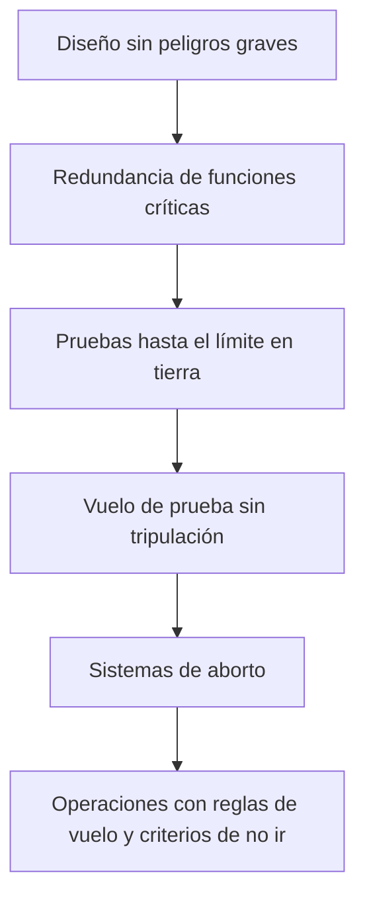

# Capítulo 7 · Fiabilidad, fallos y contingencias

## Por qué existe este capítulo

Artemis I es un manual de cómo se gestiona un cohete nuevo: se **detiene la cuenta atrás** cuando algo no cuadra, se **vuelve al edificio de ensamblaje** si viene un huracán y se **acepta un hallazgo** en vuelo como un resultado, no como un fracaso.

## Lo que pasó antes de despegar (⚠ contrasta con las fuentes oficiales)

| Fecha | Evento | Decisión |
|---|---|---|
| 29 ago 2022 | Un motor no alcanzaba la temperatura de enfriamiento prevista | Aplazamiento; se estudió si era un sensor |
| 3 sep 2022 | Fuga de hidrógeno en una conexión de llenado | Aplazamiento; reparación y nueva prueba |
| fin sep 2022 | Huracán Ian | El cohete volvió al edificio de ensamblaje |
| nov 2022 | Huracán Nicole sobre la plataforma | El cohete aguantó en la plataforma; se verificaron daños |
| 16 nov 2022 | Despegue | |

**Lección de método:** cada aplazamiento es el sistema de decisión funcionando. Una misión que **nunca** se detiene por una señal dudosa es una misión que acabará fallando en vuelo.

## Capas de protección en una misión tripulada

*Descripción textual del diagrama:* seis capas sucesivas; si falla una, queda la siguiente. En el orden: eliminar el peligro por diseño, duplicar lo crítico, probar en tierra, probar en vuelo sin personas, abortar si algo sale mal y operar con reglas claras.

## El sistema de aborto

En el ascenso, una torre con cohetes puede **separar la cápsula del cohete** en milisegundos si algo falla, y llevarla lejos para que descienda con paracaídas. Se activa si el cohete se desvía, explota o pierde empuje. Se prueba **antes** de volar con personas (en una prueba específica en tierra y en vuelo, ⚠ verificar fechas). Los abortos más difíciles son los de **mínima altitud** y los de **máxima presión dinámica**.

## Probabilidad de pérdida de tripulación

La NASA fija requisitos de seguridad para vuelos tripulados expresados como **probabilidad de pérdida de tripulación (LOC)**, con un valor máximo permitido por misión (por ejemplo, del orden de 1 en 200 o mejor; ⚠ verifica el requisito vigente). Se calcula con el análisis de riesgo probabilista, y **se mide con datos reales** conforme se acumulan vuelos. El laboratorio (sección 7) muestra por qué una cadena larga de eventos «muy fiables» ya acumula un riesgo de varios por ciento.

## Márgenes y verificación

- **Margen de diseño** en cargas, temperaturas y presiones.
- **Pruebas de calificación** a niveles por encima de los de vuelo y **de aceptación** con cada unidad de vuelo.
- **Pruebas integradas**: el cohete completo se probó encendiendo la etapa central en tierra (prueba de fuego estática) antes del primer vuelo.

## Ejercicio del capítulo

1. Haz una tabla con cinco **criterios de «no ir»** para tu cuenta atrás.
2. Construye el **FMEA** de la torre de escape: modos de fallo, efecto, detección y mitigación.
3. Con el laboratorio, calcula la probabilidad de éxito de tu secuencia si mejoras dos eventos de 0,990 a 0,998.
4. Explica por qué volar primero sin personas reduce el riesgo, y qué riesgos **no** reduce.

Anterior: [capítulo 6](06-operaciones-y-comunicaciones.md) · Siguiente: [capítulo 8](08-seguridad-y-radiacion.md)
