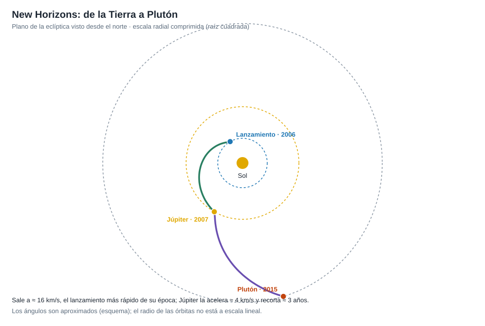
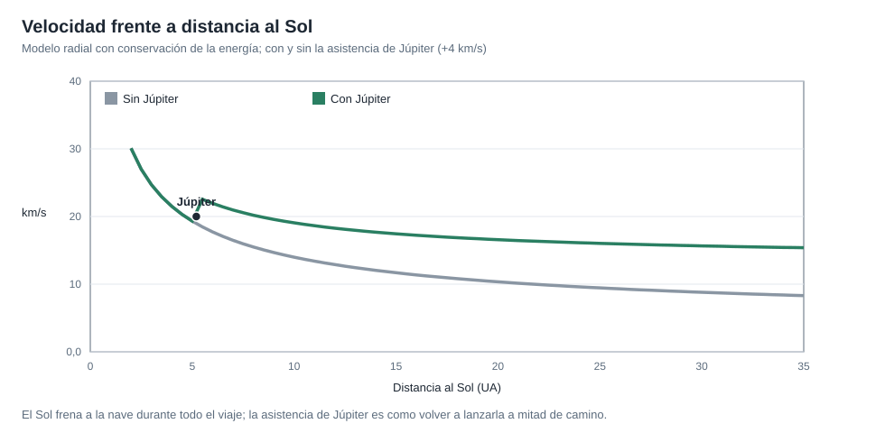

# Capítulo 2 · Ventana y trayectoria

## Por qué existe este capítulo

Plutón está a unos 32 UA. Con una transferencia de Hohmann el viaje duraría **≈ 45 años**. New Horizons lo hizo en **9,5 años** porque combinó un lanzamiento récord con una **asistencia gravitatoria de Júpiter**. Este capítulo muestra cuánto vale cada ingrediente.

*Figura 2.1.* Esquema con escala radial comprimida. Generado por [`figuras_T03.py`](figuras_T03.py).

## Primer ingrediente: salir muy rápido

Un **C3 ≈ 157 km²/s²** (⚠ cifra pública) significa una velocidad hiperbólica de salida de ≈ 12,5 km/s: al final de la quema de la última etapa, la nave iba a ≈ 16 km/s respecto a la Tierra, la más rápida de las naves lanzadas hasta entonces. El laboratorio (sección 1) lo reproduce. Sumada a los 29,8 km/s de la Tierra, la nave sale a ≈ 42,3 km/s respecto al Sol: **apenas por encima de la velocidad de escape del Sol a esa distancia**. Es decir, ya no regresa.

## Segundo ingrediente: Júpiter

Una **asistencia gravitatoria** cambia la velocidad de la nave respecto al Sol sin gastar combustible: la nave «roba» un poco de energía orbital al planeta. New Horizons pasó por Júpiter el **28 de febrero de 2007** (a unos 2,3 millones de km) y ganó ≈ **4 km/s** (⚠ cifra pública), lo que recortó el viaje en unos **tres años** (laboratorio, sección 2).

| Caso | Tiempo a Plutón (modelo radial, ±30 %) |
|---|---|
| Hohmann | ≈ 45 años |
| Salida rápida, sin Júpiter | ≈ 12 años |
| Salida rápida, con Júpiter | ≈ 8 años (real: ≈ 9,5) |

*Figura 2.2.* El Sol frena a la nave toda la ruta; Júpiter la reacelera a mitad de camino.

## La ventana: dos oportunidades y un plan B

La ventana fue **corta** porque Júpiter debía estar en el lugar adecuado:

- **Ventana principal** de unas semanas a principios de 2006 (con Júpiter).
- **Respaldo** hasta febrero de 2006.
- Si se perdía, el viaje sin Júpiter duraba **varios años más** y llegaba a Plutón en 2019-2020: no solo tardaría más, también podría coincidir con una **atmósfera de Plutón más fría** (cambia con las estaciones, ⚠ verifica) que se congelaría y se perdería parte de la ciencia.

**Lección:** una ventana no es solo energía; también es **ciencia que depende de la fecha**.

## Corrección de trayectoria

Con la nave tan rápida, un error de 1 m/s en la salida cambia la posición en Plutón en cientos de miles de kilómetros. Se planearon **correcciones** durante el viaje y una última **a las pocas semanas** del encuentro. El gasto fue muy pequeño (decenas de m/s) pero imprescindible.

## Sistema de referencia y tiempo

Heliocéntrico para el crucero; el encuentro se define en el sistema de **Plutón** (planos B, la ventana de puntería). Fechas y horas en **UTC**; el sobrevuelo estaba previsto para las 11:49 UTC del 14 de julio de 2015 (⚠ verificar).

## Ejercicio del capítulo

1. Con el laboratorio, calcula el tiempo de vuelo si la asistencia de Júpiter aporta solo 2 km/s. ¿Y si la salida fuera 10 % menos energética?
2. Redacta el plan de la **ventana**: periodo principal, respaldo y consecuencias si se pierde.
3. Explica con tus palabras por qué una asistencia gravitatoria no viola la conservación de la energía.
4. Describe las **correcciones de trayectoria** que planearías y cuándo.

Anterior: [capítulo 1](01-objetivo-y-requisitos.md) · Siguiente: [capítulo 3](03-lanzador-masas-y-vehiculo.md)
