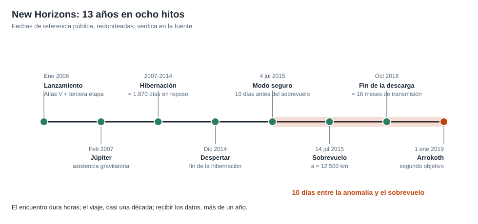

# Capítulo 5 · El sobrevuelo

## Por qué existe este capítulo

Nueve años y medio de viaje para unas **horas** de observación. Es la fase donde todo se juega, y donde no hay segunda oportunidad: la nave pasa a ≈ 13,8 km/s y no vuelve.

*Figura 5.1.* Del lanzamiento a Arrokoth. Fechas de referencia pública, redondeadas.

## Geometría del encuentro

El laboratorio (sección 3) calcula tres cosas que deciden el diseño:

| Magnitud | Valor | Consecuencia |
|---|---|---|
| Distancia mínima | ≈ 12.500 km | Resolución de ≈ 62 m por píxel con la cámara principal |
| Velocidad relativa | ≈ 13,8 km/s | Giro necesario ≈ 0,063 °/s para seguir el blanco |
| Desplazamiento en 0,05 s | ≈ 690 m | Sin seguimiento, las imágenes saldrían borrosas |

**Lo que muestra:** con esa velocidad, la nave debe **girar mientras observa** para que el objetivo quede quieto en el campo de la cámara. La secuencia de apuntado se calcula con mucha antelación.

## Una secuencia pregrabada

A 4,4 horas luz, **nadie puede mandar nada en tiempo real**. La secuencia completa del encuentro (cuándo apuntar, a qué, durante cuánto, qué instrumento enciende) se **carga con antelación** en el computador de a bordo y se ejecuta sola. En el momento de mayor acercamiento **la nave no habla con la Tierra**: apunta sus instrumentos, no su antena.

**Consecuencia:** hubo que aceptar durante unas horas que la nave estaría **incomunicada**. Si algo fallaba, no habría forma de corregirlo. Por eso la secuencia se ensayó y se simuló muchísimo.

## Qué se mide y cuándo

- **Aproximación:** mapas globales y búsqueda de lunas y anillos.
- **Acercamiento máximo:** imágenes de alta resolución, composición, ocultaciones.
- **Después del paso:** mirar atrás. Plutón queda iluminado por detrás, y el **contraluz** revela la atmósfera y sus capas de bruma (⚠ verifica la descripción en la fuente).
- **Llamada a casa:** unas 21 horas después del acercamiento, la nave debe volver a apuntar la antena a la Tierra y enviar una señal de que está bien.

## Cuando el 4 de julio de 2015 estuvo en riesgo

Diez días antes del acercamiento, la nave entró en **modo seguro**: el computador se sobrecargó al ejecutar a la vez dos tareas (⚠ contrasta los detalles en el informe del equipo). El equipo diagnosticó el problema, cambió al computador de respaldo y recuperó la nave en **unos tres días**, con el calendario del encuentro ajustado. Se discute con detalle en el capítulo 7.

## Ejercicio del capítulo

1. Calcula la resolución y la velocidad de giro para un sobrevuelo a 8.000 km y 10 km/s. ¿Qué cambia?
2. Diseña la **secuencia** del encuentro en una línea de tiempo con tres bloques (aproximación, máxima aproximación, después) y qué instrumento trabaja en cada uno.
3. Define los **criterios** con los que decidirías enviar un «llamado a casa» o dedicar más tiempo a las observaciones.
4. Calcula cuánto tarda en llegar la confirmación de que el sobrevuelo salió bien.

Anterior: [capítulo 4](04-subsistemas.md) · Siguiente: [capítulo 6](06-operaciones-y-comunicaciones.md)
