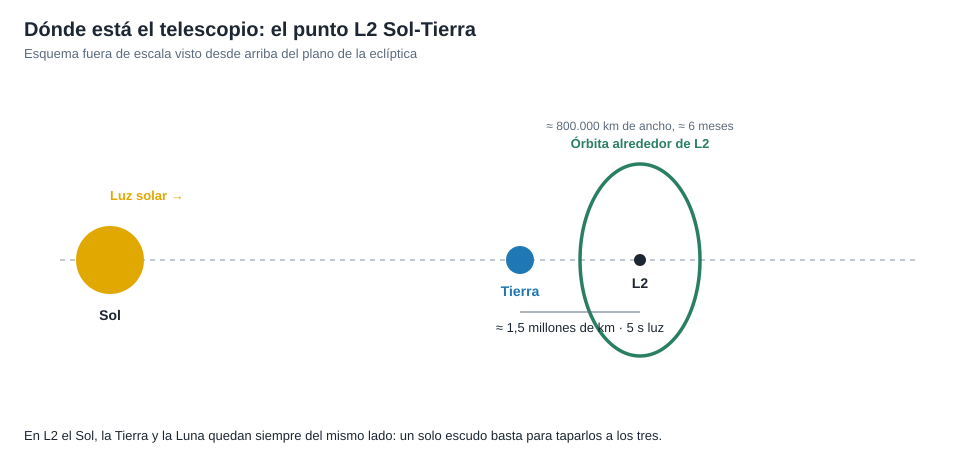

# Capítulo 2 · Ventana y trayectoria

## Por qué existe este capítulo

El telescopio vive a **1,5 millones de km** de la Tierra, en un punto donde la gravedad del Sol y de la Tierra se combinan para que un objeto gire con la Tierra alrededor del Sol sin quedarse atrás. Entender ese punto explica la elección de la órbita y el mantenimiento que necesita.

*Figura 2.1.* Esquema fuera de escala. Generado por [`figuras_T04.py`](figuras_T04.py).

## El punto L2

Cinco puntos de equilibrio de dos cuerpos (Lagrange); **L2** está en la línea Sol-Tierra, **detrás** de la Tierra. El laboratorio (sección 1) calcula su distancia con la **esfera de Hill**: r ≈ a·(m/3M)^(1/3) ≈ **1,5 millones de km**. Allí, un objeto va a ≈ 30,1 km/s alrededor del Sol, con el mismo período que la Tierra.

**Por qué ahí:**

- **Una sola dirección de sombra:** el Sol, la Tierra y la Luna quedan siempre del mismo lado; un escudo los tapa a todos.
- **Frío estable:** nada cambia la iluminación con el tiempo.
- **Lejos del calor de la Tierra** y de las perturbaciones de una órbita baja.
- **Comunicación constante:** la Tierra siempre está a la vista.

## Una órbita inestable: el halo

L2 es un equilibrio **inestable**: un objeto se aleja si no se corrige. El telescopio no se «aparca» en L2 sino que describe una **órbita de halo**, una gran trayectoria alrededor del punto (≈ 800.000 km de ancho, ≈ 6 meses por vuelta). Cada tres semanas se hace una **pequeña maniobra de mantenimiento** (centímetros por segundo). El laboratorio (sección 6) calcula el combustible: con 3 m/s por año durante 20 años bastan ≈ 175 kg de hidrazina.

## El viaje

- **Salida:** un cohete Ariane 5 desde Kourou (Guayana Francesa).
- **Tránsito:** ≈ **29 días**, durante los que se despliega el observatorio.
- **Correcciones:** tres correcciones principales; la de **inserción** el 24 de enero de 2022 puso al telescopio en su órbita de halo.
- **Precisión:** la inyección fue tan exacta que **ahorró combustible** y alargó la vida útil prevista de ≈ 10 a ≈ 20 años (⚠ verifica).

## La ventana de lanzamiento

Menos estricta que la de una misión planetaria: L2 es accesible casi todos los días, pero se fija una **ventana diaria de ≈ 30 minutos** para llegar con la geometría correcta, y los retrasos (clima, aprobaciones) se resolvieron en días. En el caso real el lanzamiento se aplazó **varias veces** por problemas de ensamblaje y de comunicación entre el telescopio y el cohete (⚠ contrasta con las crónicas oficiales).

## Ejercicio del capítulo

1. Calcula la distancia de L1 y L2 para un sistema Tierra-Luna (la masa relativa de la Luna es 0,0123) y compárala con la del sistema Sol-Tierra.
2. Explica con tus palabras por qué una órbita de halo necesita correcciones y una órbita circular alrededor de la Tierra no.
3. Calcula el retardo de luz Tierra-L2 y compáralo con el de Marte. ¿Qué operaciones permite?
4. Diseña el **plan de maniobras de mantenimiento** de un año: frecuencia, tamaño y combustible.

Anterior: [capítulo 1](01-objetivo-y-requisitos.md) · Siguiente: [capítulo 3](03-lanzador-masas-y-vehiculo.md)
