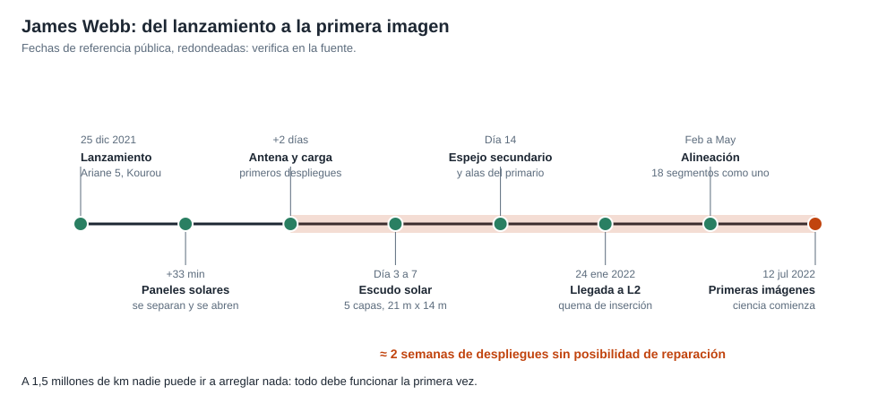
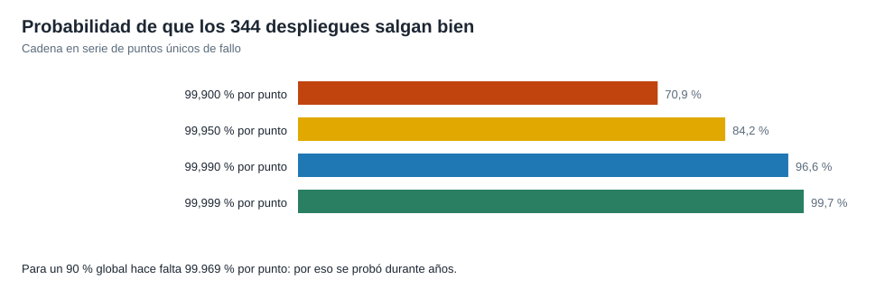

# Capítulo 5 · Los despliegues

## Por qué existe este capítulo

Es la fase crítica de esta misión: **dos semanas** en las que el observatorio se transforma de un paquete plegado en un telescopio. No hay segunda oportunidad ni forma de ayudar. La NASA habló de **344 puntos únicos de fallo** (⚠ cifra pública): piezas cuyo fallo bastaba para arruinar la misión.

*Figura 5.1.* Del lanzamiento a la primera imagen científica.

## La secuencia

1. **Separación y paneles solares** (≈ 33 minutos tras el despegue): el telescopio se separa del cohete y se despliega el panel solar. Sin energía no hay nada más.
2. **Antena de comunicación y carga.**
3. **Plataforma del escudo solar:** se extienden los soportes (días 3 a 4).
4. **Escudo solar:** se despliega y **se tensa** capa por capa (≈ 5 días): más de cien mecanismos de liberación, cables y poleas. Es la maniobra más compleja.
5. **Espejo secundario:** un mástil lo levanta frente al primario.
6. **Alas del espejo primario:** se abren las dos alas laterales y quedan los 18 segmentos en su posición.
7. **Quema de inserción** en L2 (≈ 29 días tras el lanzamiento).
8. **Enfriamiento y alineación** del espejo (varios meses).

## Qué se aprende del número 344

El laboratorio (sección 5) muestra el efecto de una cadena en serie de 344 elementos:

| Fiabilidad por punto | Éxito global |
|---|---|
| 99,900 % | ≈ 71 % |
| 99,950 % | ≈ 84 % |
| 99,990 % | ≈ 97 % |
| 99,999 % | ≈ 99,7 % |

Para un 90 % global hace falta **≈ 99,97 %** por punto. Un requisito así solo se alcanza con **muchas pruebas** y con un diseño que **reduzca el número de puntos únicos** o los haga **redundantes**.

*Figura 5.2.* Cada nueve añadido a la fiabilidad por punto vale mucho a escala de la cadena.

## Cómo se prueba algo que no se puede ensayar en su entorno

- **Despliegue en tierra** del escudo, del espejo y del mástil, con sistemas que **cancelan la gravedad** (porque los mecanismos se diseñaron para funcionar en ingravidez).
- **Pruebas en vacío y a baja temperatura** en una cámara grande (el telescopio se probó en una cámara de la NASA en Houston).
- **Pruebas de vibración y acústica** con el hardware de vuelo.
- **Simulación y revisión independiente** de cada mecanismo.

En 2018, durante pruebas, hubo **un desgarro del escudo** y **tornillos sueltos**, hallazgos que retrasaron el calendario (⚠ contrasta): son exactamente el tipo de problema que las pruebas existen para encontrar.

## Operación durante el despliegue

Una **secuencia automática** con puntos de pausa. El equipo seguía la telemetría con retardo de 5 s (laboratorio) y podía **detener y reanudar** entre pasos, con **alternativas** preparadas (por ejemplo, calentar una zona para soltar un mecanismo atascado). Cada paso tenía un **criterio de éxito** medible.

## Ejercicio del capítulo

1. Con el laboratorio, calcula el éxito global con 200 puntos a 99,98 % y con 400 puntos a 99,98 %.
2. Elabora la **secuencia de despliegue** de un observatorio con 3 mecanismos grandes: pasos, criterio de éxito y alternativa si falla.
3. Describe una **prueba en tierra** que anule la gravedad para un mecanismo de ingravidez.
4. Decide **qué puntos únicos eliminarías** con redundancia y cuáles aceptarías, con tu criterio.

Anterior: [capítulo 4](04-subsistemas.md) · Siguiente: [capítulo 6](06-operaciones-y-comunicaciones.md)
