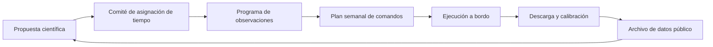

# Capítulo 6 · Operaciones y comunicaciones

## Por qué existe este capítulo

Un observatorio no se «conduce»: se **programa**. Miles de astrónomos compiten por unas horas de telescopio, y el equipo de operaciones convierte las propuestas en un plan semanal que la nave ejecuta sola.

## El ciclo de una observación

*Descripción textual del diagrama:* los astrónomos proponen; un comité asigna tiempo; operaciones arma el programa y el plan semanal; el telescopio observa solo; los datos se descargan, se calibran y se archivan. Tras un período de reserva, son públicos y alimentan nuevas propuestas.

## Reparto del tiempo

El tiempo del observatorio se reparte entre **los socios** (NASA, ESA y la agencia de Canadá) según su contribución y mediante **evaluación por pares**. La competencia es dura: la demanda supera varias veces el tiempo disponible. Esto es una decisión de **gobernanza** tanto como técnica (capítulo 9).

## El centro de operaciones

El **Instituto de Ciencia del Telescopio Espacial** (Baltimore) opera el observatorio: planifica, vigila la salud de la nave y distribuye los datos. Un **centro de control** de la NASA conserva el mando de la nave; el equipo científico y el de ingeniería comparten el calendario.

## Comunicaciones

- **Red del Espacio Profundo** (DSN): banda Ka para ciencia, banda S para comandos.
- **Retardo de luz:** ≈ 5 s a L2 (laboratorio, sección 1): comunicación casi en directo.
- **Volumen:** ≈ 28 GB al día, ≈ 2,4 horas de enlace diarias a 25,9 Mbit/s (laboratorio, sección 7).
- **Contactos programados** varias veces al día para descargar y para comandos.

## Calibración y salud

Antes de la ciencia hay **meses de puesta en marcha**: alinear el espejo, calibrar cada instrumento y comprobar el rendimiento con objetivos conocidos. Después, **monitoreo continuo**: temperatura, deriva del espejo, estado del escudo y consumo de combustible.

## Lo que no se puede hacer

**Servicio:** no hay forma de reemplazar una pieza. El telescopio se diseñó con **redundancia** y con **margen de vida**; operarlo bien es la forma de reparar. Se cuida cada maniobra y cada actividad que pueda dañarlo (por ejemplo, evitar apuntar a zonas que dañen los detectores o que calienten el espejo).

## Ejercicio del capítulo

1. Diseña un **proceso de asignación de tiempo**: criterios, evaluadores y plazos para 1.000 propuestas y 500 horas.
2. Calcula el volumen y las horas de enlace para un instrumento que produce 100 Mbit/s durante 4 horas al día.
3. Haz una lista de **restricciones de apuntado** de tu observatorio y su razón.
4. Describe la **vigilancia de salud** de un día: qué parámetros miras y qué umbrales disparan una alerta.

Anterior: [capítulo 5](05-los-despliegues.md) · Siguiente: [capítulo 7](07-fiabilidad-fallos-y-contingencias.md)
