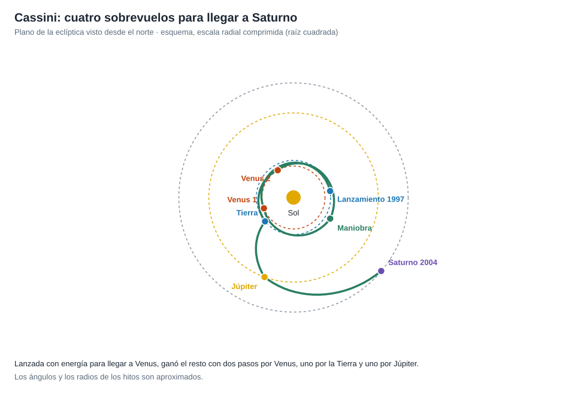
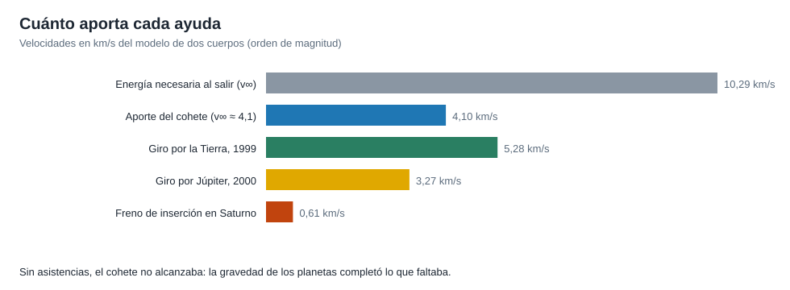

# Capítulo 2 · Ventana y trayectoria

## Por qué existe este capítulo

Con un cohete de la época no se podía enviar la nave directamente a Saturno. La solución fue un recorrido de **seis años y medio** con **cuatro sobrevuelos planetarios**: una **asistencia gravitatoria** por planeta, para ganar velocidad sin gastar combustible. Se la conoce como la trayectoria **VVEJGA** (Venus, Venus, Tierra, Júpiter).

*Figura 2.1.* Esquema con escala radial comprimida. Generado por [`figuras_T05.py`](figuras_T05.py).

## La energía que falta

El laboratorio (sección 1) calcula que una transferencia directa Tierra-Saturno exigiría una v∞ de **10,3 km/s** (C3 ≈ 106 km²/s²). El cohete (Titan IV con etapa Centaur) dio un C3 de **≈ 16 km²/s²** (⚠ cifra pública): mucho menos. La diferencia la aportaron los planetas.

*Figura 2.2.* Orden de magnitud de cada aporte, con el modelo de dos cuerpos.

## Cómo funciona una asistencia gravitatoria

En el sistema de referencia del planeta, la nave entra y sale con la **misma velocidad** (en módulo), pero **gira** su dirección. Visto desde el Sol, el planeta se mueve: ese giro cambia la velocidad de la nave respecto al Sol. El laboratorio (sección 2) calcula:

| Sobrevuelo | Giro máximo de la velocidad | Cambio de velocidad (módulo del vector) |
|---|---|---|
| Venus 1999 (≈ 600 km) | ≈ 33° | ≈ 6,3 km/s |
| Tierra 1999 (1.166 km) | ≈ 18° | ≈ 5,3 km/s |
| Júpiter 2000 (≈ 9,7 millones de km) | ≈ 33° | ≈ 3,3 km/s |

La fórmula es Δv = 2·v∞·sin(δ/2), con sin(δ/2) = 1/(1 + r_p·v∞²/μ). A **menor distancia** de paso, **mayor giro**; pero pasar muy cerca de un planeta con atmósfera es peligroso.

## La secuencia real (⚠ fechas redondeadas)

1. **Lanzamiento**: 15 de octubre de 1997.
2. **Venus**: abril de 1998 y junio de 1999.
3. **Maniobra en el espacio profundo** de ≈ 450 m/s (diciembre de 1998) para ajustar el segundo paso por Venus.
4. **Tierra**: agosto de 1999 (a 1.166 km de altura).
5. **Júpiter**: diciembre de 2000, con ciencia incluida.
6. **Saturno**: 1 de julio de 2004.

El camino se eligió porque dio la **mejor masa disponible**: una trayectoria más directa habría exigido un cohete que no existía.

## Un riesgo del plan

El **paso por la Tierra** (1999) pasó a unos mil kilómetros con una nave que llevaba material nuclear. Aunque la probabilidad de un error era minúscula, fue objeto de **revisión pública y de seguridad**. Es una consecuencia de **elegir energía gratuita a cambio de riesgo político y de seguridad**.

## La ventana

Las asistencias exigen una **alineación** de los planetas poco frecuente: la ventana de lanzamiento fue de unas semanas y la de reserva, de meses; si se perdía, el calendario cambiaba por años. Esto es **ciencia y política** a la vez: se tuvo que decidir con años de antelación.

## Ejercicio del capítulo

1. Con el laboratorio, calcula el giro y el cambio de velocidad para un paso por la Tierra a 300 km y a 5.000 km de altura. ¿Qué compromiso ves?
2. Explica con un esquema vectorial cómo cambia la velocidad respecto al Sol sin que cambie el módulo respecto al planeta.
3. Diseña tu propia secuencia de asistencias para una misión a Urano: planetas, fechas aproximadas y riesgos.

Anterior: [capítulo 1](01-objetivo-y-requisitos.md) · Siguiente: [capítulo 3](03-lanzador-masas-y-vehiculo.md)
