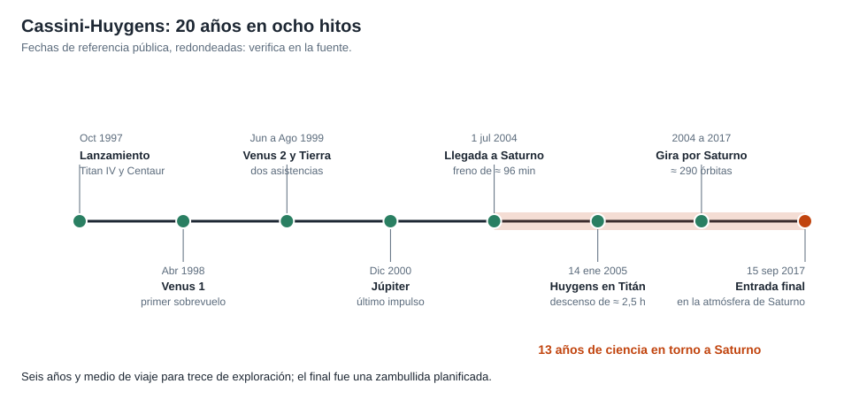

# Capítulo 5 · Inserción y descenso a Titán

## Por qué existe este capítulo

Dos eventos críticos, cada uno de **una sola oportunidad**: frenar para quedar en órbita de Saturno el 1 de julio de 2004, y **posar una sonda** en Titán el 14 de enero de 2005.

*Figura 5.1.* Del lanzamiento a la entrada final.

## La inserción en órbita

La nave llegó a Saturno a ≈ 5,5 km/s respecto al planeta (⚠). Si no frenaba, seguía de largo. Una **quema de ≈ 96 minutos** del motor principal la dejó en una órbita elíptica de ≈ 116 días.

El laboratorio (sección 3) calcula, para un periapsis de 78.000 km:

| Magnitud | Valor |
|---|---|
| Velocidad en el periapsis antes de frenar | ≈ 31,7 km/s |
| Delta-v de la quema | ≈ 614 m/s (real ≈ 626 m/s) |
| Apoapsis de la órbita | ≈ 9,1 millones de km |

**Detalles que lo hicieron arriesgado:**

- **Pasar entre los anillos** (por un hueco libre de partículas grandes) con la antena como escudo y la nave orientada «de popa»: un grano grande a 30 km/s sería fatal.
- **Una quema larga** que, si se interrumpía, **no podía repetirse**: un solo intento.
- **Comunicación solo por señales de estado** durante la quema, con 84 minutos de retardo.

La quema salió bien. A las pocas horas, el equipo recibió la confirmación.

## El descenso de Huygens

La sonda se **soltó del orbitador** el 25 de diciembre de 2004 y viajó **tres semanas** sola hasta Titán. Luego:

1. **Entrada** a ≈ 6 km/s en la atmósfera, con un escudo térmico.
2. **Paracaídas** principal y luego uno más pequeño que estabilizó la caída.
3. **Descenso de ≈ 2,5 horas** midiendo temperatura, presión, composición y fotografiando el paisaje.
4. **Contacto** a unos 4 a 5 m/s; la sonda **siguió transmitiendo ≈ 72 minutos** desde la superficie (⚠ verifica en la fuente) hasta que el orbitador se alejó.

El laboratorio (sección 4) calcula la **velocidad terminal** con un paracaídas pequeño en esa atmósfera (≈ 1,5 bar, gravedad de 1,35 m/s²): ≈ 3,9 m/s, consistente con el contacto real.

## El problema de la señal

Durante el descenso la sonda **no transmitía a la Tierra**, sino al orbitador (que pasaba cerca) y éste lo grababa para retransmitirlo después. Si algo fallaba en ese relevo, **se perdía todo**. Y se había descubierto, ya en vuelo, un defecto de diseño (capítulo 7).

## Cómo se prepara una sola oportunidad

- **Secuencia autónoma** pregrabada (con temporizadores) en la sonda, porque no hay comunicación en tiempo real.
- **Ensayos de extremo a extremo** con el hardware real y simuladores.
- **Redundancia** de ciertos relevos (por ejemplo, receptores y temporizadores duplicados).
- **Reglas de decisión:** cuándo continuar y cuándo abortar la liberación.

## Ejercicio del capítulo

1. Con el laboratorio, calcula el delta-v de inserción para periapsis de 60.000 km y 100.000 km. ¿Qué compensa cada elección?
2. Calcula la velocidad terminal para un paracaídas de 5 m en Titán y en Marte (ρ ≈ 0,02 kg/m³, g = 3,7 m/s²).
3. Redacta la **secuencia autónoma** de una sonda de descenso con cuatro eventos y sus temporizadores.

Anterior: [capítulo 4](04-subsistemas.md) · Siguiente: [capítulo 6](06-operaciones-y-comunicaciones.md)
