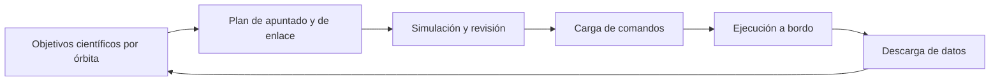

# Capítulo 6 · Operaciones y comunicaciones

## Por qué existe este capítulo

Trece años en órbita de Saturno son **cientos de órbitas**, cada una con su plan. La operación de Cassini es el ejemplo de cómo se **planifica una gira** y de cómo un descubrimiento en el camino (los géiseres de Encélado) puede cambiar el plan.

## Una gira de encuentros

La nave no se queda en una órbita fija: usa la **gravedad de Titán** para cambiarla. Cada sobrevuelo de Titán modifica la órbita y prepara el siguiente encuentro con otra luna o con los anillos. La planificación de la gira se resolvió a mano y con optimización durante años: era como un juego de billar con la gravedad.

**Una consecuencia de diseño:** el combustible solo alcanza porque la gira **usa la gravedad de Titán** en lugar de motores. Cada maniobra propulsada es pequeña y ocasional.

## Ciclo de planificación

*Descripción textual del diagrama:* cada órbita (de días a semanas) tiene un ciclo: se fijan los objetivos, se arma el plan de apuntado y de enlace, se simula y se revisa, se carga, la nave lo ejecuta y los datos regresan para preparar la siguiente.

## El conflicto de apuntado

La antena de 4 m y los instrumentos están fijos en la nave: **o apuntas la antena a la Tierra o apuntas los instrumentos al blanco**. Las observaciones de ciencia se alternan con **ventanas de enlace**, y los datos se guardan en grabadoras. Eso fija el ritmo: observar, girar, transmitir.

## El rediseño de la misión por el enlace de la sonda

Antes de llegar a Saturno se descubrió un defecto en el **enlace entre la sonda y el orbitador** (capítulo 7). La solución fue **rediseñar la trayectoria** de la primera parte de la misión, cambiando el momento y la geometría de la liberación de la sonda. Es un ejemplo de cómo las operaciones pueden **corregir un defecto de hardware con planificación**.

## El descubrimiento de Encélado

Las observaciones de 2005 mostraron **chorros de vapor y hielo** saliendo del polo sur de la pequeña luna Encélado. El equipo **reasignó observaciones** y modificó la gira para sobrevolarla más veces y más cerca, incluso atravesando los chorros. Es un ejemplo de **flexibilidad científica**: un plan que se deja cambiar.

## Comunicaciones

- Retardo de 68 a 84 min (laboratorio).
- Red del Espacio Profundo, con contactos de varias horas diarias.
- **Datos de radio** para ciencia: la propia señal, al atravesar los anillos y la atmósfera, mide su estructura.

## El equipo

Un grupo internacional de cientos de personas, con centros de operaciones en California y equipos científicos en varios países. El **Proceso de planificación** fue una negociación continua entre las necesidades de instrumentos que competían por el tiempo de apuntado.

## Ejercicio del capítulo

1. Diseña un **calendario de apuntado** de una órbita de 16 días con tres instrumentos que compiten y dos ventanas de enlace.
2. Calcula el volumen de datos que cabe en una grabadora de 4 Gbit y cuántas horas de enlace hacen falta para descargarlo a 100 kbit/s.
3. Escribe el **procedimiento para reasignar observaciones** ante un descubrimiento inesperado: quién decide, con qué criterios y plazos.

Anterior: [capítulo 5](05-insercion-y-descenso-a-titan.md) · Siguiente: [capítulo 7](07-fiabilidad-fallos-y-contingencias.md)
