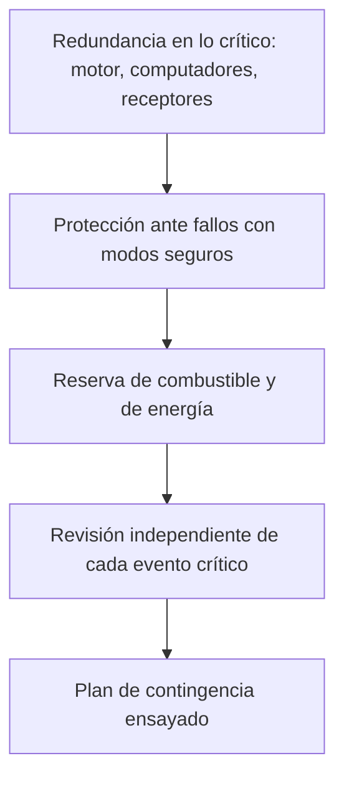

# Capítulo 7 · Fiabilidad, fallos y contingencias

## Por qué existe este capítulo

El caso Cassini-Huygens enseña lo que ocurre cuando un **defecto se descubre en vuelo**, y cómo un equipo lo **resuelve con planificación en lugar de con una reparación**.

## El defecto del enlace de la sonda (⚠ contrasta con los informes oficiales)

En 2000, durante una prueba en vuelo, se detectó que el **receptor del orbitador** que recibiría la señal de la sonda **no podría seguir** el desplazamiento de frecuencia (efecto Doppler) previsto durante el descenso. La causa: el diseño no había considerado el efecto de la velocidad relativa orbitador-sonda al pasar por Titán con la geometría original. Si se dejaba así, **se habría perdido buena parte de los datos**.

**La solución:**

1. Se **modificó la trayectoria** del orbitador: se acercó a Titán a otra distancia y con otra geometría, de modo que el Doppler fuera menor.
2. Se **adelantó el cronograma** de la liberación de la sonda (diciembre de 2004) y se **atrasó** el descenso a enero de 2005.
3. Se **verificó** con pruebas de enlace en tierra con un equipo gemelo.

Así, un problema de hardware se resolvió **moviendo la nave**, no cambiando la pieza. Un detalle clave: se descubrió porque **se hizo una prueba de extremo a extremo** que nadie estaba obligado a hacer.

**Lección:** las pruebas de **interfaz real** con condiciones reales (Doppler, retardos, ruido) encuentran errores que las pruebas por separado no ven.

## Capas de protección de la misión

*Descripción textual del diagrama:* cinco capas: lo crítico duplicado, la nave que se pone a salvo sola, reservas de combustible y energía para absorber sorpresas, revisión externa de cada hito y contingencias ensayadas.

## Fiabilidad en serie

El laboratorio (sección 7) calcula, con valores ilustrativos, la probabilidad de que cinco grandes eventos salgan bien en cadena: ≈ 0,88. Es un modo de ver que **una misión de cuatro grandes hitos casi nunca es «segura»**, y que el riesgo se reparte.

## Contingencias reales

- **Modo seguro** tras una anomalía menor: la nave se detiene, apunta la antena y espera. Hubo varios episodios, resueltos con procedimientos ensayados.
- **Un instrumento averiado:** se reasigna el tiempo y se sigue con el resto.
- **Un motor de respaldo** disponible por si el principal fallaba: se conmutó a él en las maniobras importantes.

## Márgenes que salvaron la misión

El **combustible sobrante** permitió **extender** la misión varias veces; la **energía** sobró por el diseño conservador; y la **robustez** del conjunto permitió vivir 13 años en vez de 4.

## Ejercicio del capítulo

1. Diseña una **prueba de extremo a extremo** para el enlace entre una sonda y su orbitador: condiciones, equipo y criterios de éxito.
2. Calcula la probabilidad de éxito de una cadena de cuatro eventos con 0,97, 0,98, 0,95 y 0,99. ¿Cuál mejorarías primero y por qué?
3. Haz un **FMEA** de tres filas para la inserción en órbita.
4. Describe qué otras **soluciones de planificación** (en lugar de hardware) puedes usar cuando se descubre un defecto en vuelo.

Anterior: [capítulo 6](06-operaciones-y-comunicaciones.md) · Siguiente: [capítulo 8](08-seguridad-y-proteccion-planetaria.md)
