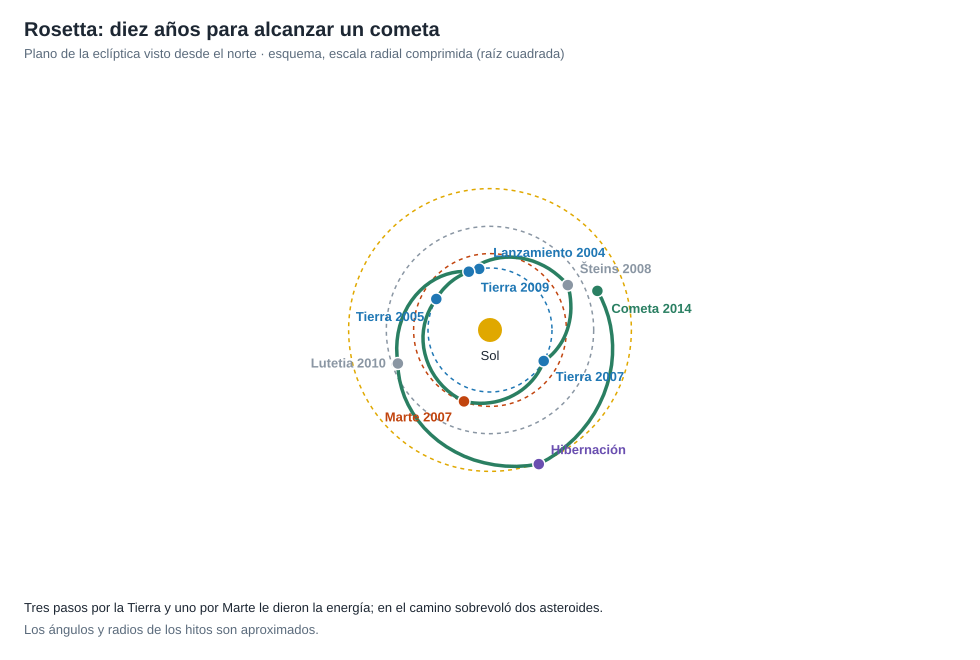

# Capítulo 2 · Ventana y trayectoria

## Por qué existe este capítulo

Alcanzar un cometa **y quedarse con él** exige igualar su velocidad, que es una enorme cantidad de energía. Rosetta la consiguió con **diez años de viaje y cuatro asistencias gravitatorias** (tres por la Tierra y una por Marte), con pasos por dos asteroides de regalo.

*Figura 2.1.* Esquema con escala radial comprimida. Generado por [`figuras_T06.py`](figuras_T06.py).

## Por qué tantas asistencias

El cometa tiene una órbita **excéntrica**: se acerca al Sol hasta ≈ 1,24 UA y se aleja hasta ≈ 5,7 UA. Para encontrarlo y **igualar su velocidad** a ≈ 3,4 UA hacía falta mucha energía y un tiempo largo. Un cohete directo no podía; con **asistencias** de la Tierra y de Marte, la nave **ganó la energía** sin gastar combustible. Cada paso por la Tierra volvía a dar la vuelta al Sol y a ajustar la órbita.

## La secuencia (⚠ fechas redondeadas)

1. **Lanzamiento:** 2 de marzo de 2004, con un Ariane 5 desde Kourou.
2. **Tierra:** marzo de 2005; **Marte:** febrero de 2007; **Tierra:** noviembre de 2007 y noviembre de 2009.
3. **Asteroides:** Šteins (2008) y Lutetia (2010), aprovechando el camino.
4. **Hibernación:** de junio de 2011 a enero de 2014, en la parte más lejana de la órbita (≈ 5,3 UA).
5. **Maniobras de aproximación** y frenado (2014).
6. **Llegada al cometa:** 6 de agosto de 2014, con unos **100 km** de distancia y una velocidad relativa de pocos m/s.

## Un cambio de objetivo por un fallo ajeno

El plan original era visitar el cometa **46P/Wirtanen**, con lanzamiento en enero de 2003. Un **fallo de un Ariane 5** a fines de 2002 detuvo la flota de lanzadores y la ventana se perdió. Esperar otra ventana al mismo cometa era imposible; el equipo **cambió el objetivo** al cometa 67P, con un lanzamiento en 2004 y un viaje más largo. **Moraleja:** la ventana de lanzamiento puede perderse por motivos que no controla el equipo; un objetivo alternativo con otra trayectoria es parte de la planificación.

## Igualar la velocidad del cometa

Cuando llegó, la nave quedó a unos pocos m/s del cometa y frenó con maniobras pequeñas. El laboratorio (sección 1) da los números del cometa: velocidad de escape ≈ 0,9 m/s, velocidad orbital rasante ≈ 0,6 m/s y período ≈ 4,7 horas (en el modelo esférico). A decenas de kilómetros de altura, las órbitas duran días (sección 4: 2,8 días a 10 km y 14,6 días a 30 km).

## Sistema de referencia

Heliocéntrico para el viaje, **cometocéntrico** para la operación (con el cuerpo fijo y su rotación como una perturbación). **Fechas en UTC**.

## Ejercicio del capítulo

1. Calcula con el laboratorio el período y la velocidad de una órbita a 15 km del cometa. ¿Qué precisión de navegación hace falta para no chocar?
2. Explica por qué una nave que debe igualar la velocidad de un cuerpo necesita más energía que una que solo lo sobrevuela.
3. Diseña un **plan alternativo de objetivo** para una ventana que puede perderse, con el criterio para cambiar.

Anterior: [capítulo 1](01-objetivo-y-requisitos.md) · Siguiente: [capítulo 3](03-lanzador-masas-y-vehiculo.md)
