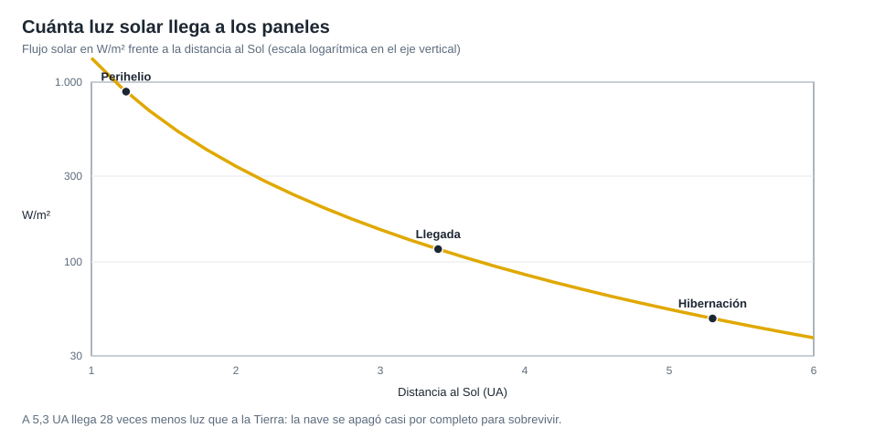

# Capítulo 4 · Subsistemas

## Por qué existe este capítulo

Rosetta usó **energía solar a más de 5 UA del Sol**, algo que nunca se había intentado con una nave de ese tamaño. La clave de todo el diseño de subsistemas fue **cuánta luz llega** y qué se puede hacer con ella.

*Figura 4.1.* A 5,3 UA llega 28 veces menos luz que a la Tierra.

## Potencia

El laboratorio (sección 2) calcula, para 64 m² de paneles con eficiencia del 18 %:

| Lugar | Flujo (W/m²) | Potencia aprox. |
|---|---|---|
| Tierra (1 UA) | 1.361 | ≈ 15.700 W |
| Perihelio del cometa (1,24 UA) | 885 | ≈ 10.200 W |
| Cinturón (3 UA) | 151 | ≈ 1.700 W |
| Hibernación (5,3 UA) | 48 | ≈ 560 W |

A 5,3 UA la potencia se queda en algo más de media decena de cientos de vatios (¡para una nave que, en funcionamiento normal, necesita mucho más!). **Decisión de diseño:** en esa parte de la órbita **hibernar** (apagar casi todo), y calentar solo lo imprescindible.

### Paneles de celdas de alta eficiencia

Celdas diseñadas para **baja intensidad y baja temperatura** (LILT), que mantienen buen rendimiento en la oscuridad y el frío. Se pueden **orientar** para recibir la luz con el ángulo óptimo.

## Térmica

En hibernación hay que impedir que la electrónica se **congele**: unos pocos calefactores con pocos vatios, aislamiento y un diseño que usa el **calor de los equipos**. A 3 UA o menos, el problema pasa a ser el contrario.

## Cómputo y control

Computadores redundantes y un **sistema de supervisión** que puede reiniciar la nave y recuperarla de errores. Durante la hibernación la nave **gira lentamente** (≈ 1 vuelta por minuto) para mantenerse estable con las antenas apuntando al Sol y a la Tierra.

## Comunicaciones

- Antena de alta ganancia (≈ 2,2 m) y antenas de baja ganancia para emergencias.
- **Retardo de luz:** a 3 UA ≈ 25 min en un sentido; a 5,3 UA ≈ 44 min (laboratorio, sección 5).
- Enlace con la **Red del Espacio Profundo** de la ESA (con antenas de 35 m) y de la NASA.

## Propulsión

Un sistema de **dos componentes** (monometilhidracina y óxido nitroso) con motores grandes para las maniobras principales y pequeños para correcciones. Su fiabilidad tras años de **hibernación** fue un riesgo de diseño: las válvulas y los depósitos debían funcionar tras más de 7 años de uso y 2,6 años de inactividad.

## Instrumentos

Once en el orbitador (espectrómetros de masa, cámaras, instrumentos de polvo, plasma y radio, entre otros) y diez en la sonda (⚠ verifica en la fuente).

## Ejercicio del capítulo

1. Calcula la potencia de paneles de 40 m² al 20 % a 4 UA y a 5,5 UA, y determina si alcanza para una nave que consume 400 W en hibernación.
2. Diseña un **modo de hibernación**: qué sistemas quedan encendidos, con cuántos vatios y cómo se despierta.
3. Explica por qué una nave que gira lentamente es más estable que una que no gira.

Anterior: [capítulo 3](03-lanzador-masas-y-vehiculo.md) · Siguiente: [capítulo 5](05-encuentro-y-aterrizaje.md)
