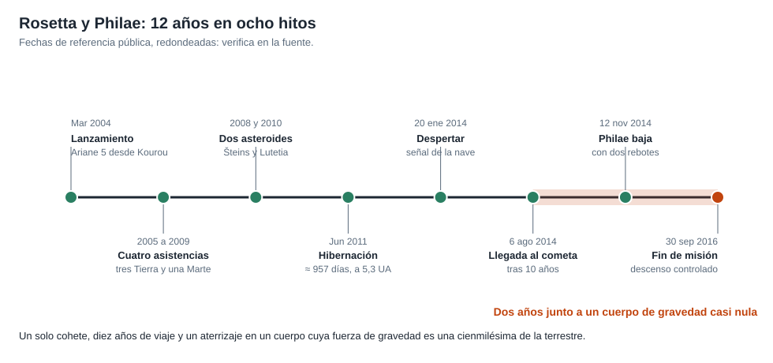

# Capítulo 5 · Encuentro y aterrizaje

## Por qué existe este capítulo

Hay dos problemas distintos: **acercarse a un cuerpo activo y de forma extraña** y **soltar una sonda** en un lugar donde la gravedad es una cienmilésima de la terrestre y un error de un metro por segundo la hace volar.

*Figura 5.1.* Del lanzamiento al final de la misión.

## El cuerpo

El cometa 67P tiene **dos lóbulos** unidos por un cuello (parece un patito de goma), de ≈ 4 km de largo. Su gravedad es mínima; el laboratorio (sección 1) calcula, con un modelo esférico:

| Magnitud | Valor |
|---|---|
| Gravedad en la superficie | ≈ 0,23 mm/s² |
| Velocidad de escape | ≈ 0,9 m/s |
| Un cuerpo de 100 kg «pesa» | ≈ 23 mN (como 2 g en la Tierra) |

**Consecuencia:** un objeto que rebote a más de ≈ 0,9 m/s **escapa**. La ingeniería de aterrizaje de Philae tenía que **no rebotar**.

## La aproximación

1. **Frenado** hasta una distancia de unos 100 km y una velocidad relativa de pocos m/s.
2. **Triángulos de aproximación** a 100, 50 y 30 km para fotografiar el cometa y modelar su forma.
3. **Órbitas** de unos 10 a 30 km de altura (laboratorio, sección 4) a velocidades de 15 a 26 cm/s.
4. **Elección del sitio de aterrizaje**, con meses de estudio de imágenes: pendientes, rocas, iluminación y visibilidad para el enlace.

## El aterrizaje de Philae (12 de noviembre de 2014)

1. **Separación** del orbitador y caída libre de ≈ 7 horas (⚠ verifica en la fuente).
2. **Contacto con el suelo:** el propulsor de gas frío que debía **apretar** la sonda no funcionó, y los **arpones** no se dispararon.
3. **Primer rebote:** subió unos cientos de metros (la fuente habla de ≈ 1 km) durante ≈ 2 horas (⚠), con una velocidad por debajo de la de escape (laboratorio, sección 3).
4. **Segundo contacto y rebote corto**, hasta quedar **inclinada** en un lugar a la sombra de un acantilado.

El laboratorio muestra cómo, con un coeficiente de restitución de 0,3, una llegada a 1 m/s produce un rebote de decenas a centenas de metros y de más de media hora en el aire: **en gravedad casi nula, un rebote es largo**.

## Resultado

Philae trabajó unas **60 horas** con su batería (⚠) y envió datos de gran valor, incluyendo los primeros análisis in situ de la superficie de un cometa. Pero, en la sombra, no recargó sus baterías y **calló**. Volvió a comunicarse unos meses después, al acercarse el cometa al Sol, por poco tiempo. En 2016 se **localizó** su posición con imágenes del orbitador.

## Lo que se logró aun con el fallo

- Datos de composición orgánica de la superficie.
- Propiedades mecánicas de la capa externa.
- **Un valioso conjunto de imágenes** del lugar y del descenso.

**Lección:** una misión bien planificada tiene **un plan en el que el éxito parcial cuenta**: la secuencia de la sonda estaba **priorizada** para entregar primero los datos más importantes.

## Ejercicio del capítulo

1. Con el laboratorio, calcula la altura y el tiempo de un rebote con restitución 0,5 y llegada a 0,5 m/s. ¿Escapa?
2. Diseña un **sistema de anclaje** para un cuerpo de gravedad casi nula (al menos dos mecanismos independientes) y explica su modo de fallo.
3. Elabora una **lista de prioridades de la ciencia de la sonda**: qué mides primero si solo hay tiempo para la mitad.
4. Diseña el criterio de **elección del sitio** con cinco factores y sus pesos.

Anterior: [capítulo 4](04-subsistemas.md) · Siguiente: [capítulo 6](06-operaciones-y-comunicaciones.md)
