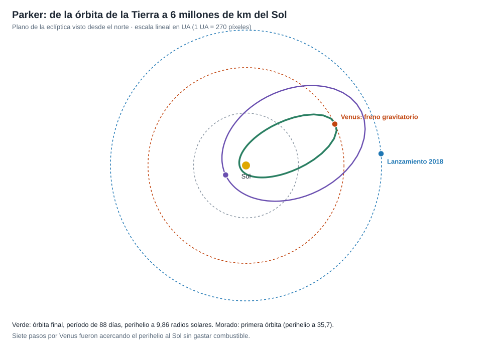

# Capítulo 2 · Ventana y trayectoria

## Por qué existe este capítulo

Ir al Sol exige lo contrario que ir a los planetas: hay que **perder** velocidad. La Tierra se mueve a 29,8 km/s; para dejarse caer cerca del Sol hay que cancelar casi toda esa velocidad orbital. Aquí se ve por qué lo imposible se logra con **un cohete récord y siete pasos por Venus**.

*Figura 2.1.* Escala lineal en UA. Generado por [`figuras_T07.py`](figuras_T07.py).

## Cuánto hay que frenar

El laboratorio (sección 1) calcula que, desde una órbita terrestre, llegar a un perihelio de 9,86 R☉ exige perder ≈ **21 km/s** de velocidad: un C3 equivalente de ≈ 440 km²/s². El cohete (Delta IV Heavy con una tercera etapa) dio ≈ **154 km²/s²** (⚠ cifra pública), un récord, pero **insuficiente**. Lo demás lo hace Venus.

## Frenar con Venus

Una **asistencia gravitatoria** puede **frenar** si se pasa por la parte del planeta que se mueve en el sentido correcto: la nave cede un poco de energía orbital al planeta (que no lo nota) y pierde velocidad respecto al Sol (cap. 2 de T05). Cada paso por Venus **baja el perihelio** de la nave.

| Hito | Perihelio aproximado |
|---|---|
| Primera órbita (nov 2018) | 35,7 R☉ (≈ 0,17 UA) |
| Órbitas intermedias | 27,8 → 20 → 16 → 13 R☉ |
| Última órbita (desde dic 2024) | 9,86 R☉ (≈ 0,046 UA) |

Siete pasos por Venus entre 2018 y 2024 llevaron el perihelio de 35,7 a 9,86 R☉ y el período a **88 días**. El laboratorio (sección 2) calcula la órbita final: semieje mayor ≈ 0,387 UA, afelio ≈ 0,73 UA (justo en la órbita de Venus, lo que permite seguir pasando por él) y una velocidad de **≈ 191 km/s** en el perihelio.

## La ventana

La ventana de lanzamiento fue de **dos semanas** (julio-agosto de 2018) con un tiempo diario de unos 65 minutos (⚠ verifica): el primer paso por Venus debía ocurrir en octubre del mismo año con una geometría exacta. Perder la ventana obligaba a esperar otra con una geometría distinta (⚠ verifica el plan de reserva en la fuente).

## Sistema de referencia y tiempo

Heliocéntrico en el plano de la eclíptica (la órbita real está inclinada ≈ 3,4° respecto a él). **Fechas en UTC.** El perihelio se define **desde el centro del Sol**, no desde la superficie; 9,86 R☉ equivalen a ≈ 6,1 millones de km sobre la superficie.

## Cálculos

Con el laboratorio: la nave recorre una distancia igual al diámetro del Sol (1,39 millones de km) en unas **2 horas** al ir a 191 km/s en el perihelio.

## Ejercicio del capítulo

1. Calcula la velocidad en el perihelio para perihelios de 20, 15 y 9,86 R☉ con período de 88 días.
2. Explica con un esquema vectorial cómo un paso por Venus **frena** la nave en lugar de acelerarla.
3. Diseña una secuencia de **cuatro asistencias** para llevar un perihelio de 40 a 15 R☉ y dibuja la tabla de períodos y resonancias.
4. Explica por qué el afelio final coincide con la órbita de Venus.

Anterior: [capítulo 1](01-objetivo-y-requisitos.md) · Siguiente: [capítulo 3](03-lanzador-masas-y-vehiculo.md)
