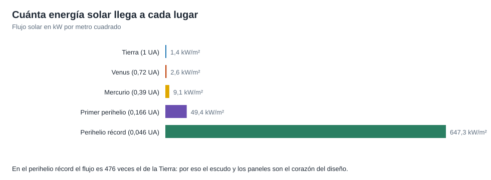

# Capítulo 4 · Subsistemas

## Por qué existe este capítulo

La nave vive en un lugar donde el flujo de energía solar es **476 veces** el de la Tierra. Cada subsistema es una respuesta a un solo problema: **sobrevivir y seguir midiendo**.

*Figura 4.1.* El flujo crece con el cuadrado de la proximidad al Sol.

## Escudo térmico

Una placa de **carbono-carbono** de ≈ 11,5 cm de espesor con núcleo de espuma de carbono y un **recubrimiento cerámico blanco** en la cara solar. Debe soportar ≈ 1.650 K (≈ 1.400 °C) en el frente mientras la nave detrás queda a temperaturas ambiente (≈ 30 °C).

El laboratorio (sección 3) calcula la temperatura de equilibrio de una placa que mira al Sol:

| Superficie | Temperatura |
|---|---|
| Absorbente ideal (α/ε = 1) | ≈ 1.840 K (≈ 1.565 °C) |
| Recubrimiento blanco (α/ε = 0,7) | ≈ 1.680 K (≈ 1.410 °C) |

**Decisión de diseño:** un recubrimiento que **absorbe menos de lo que emite** baja la temperatura sin añadir masa. El **espesor** y la espuma interna hacen que el calor llegue muy débil a la parte trasera.

**Detalle clave:** la nave debe **permanecer detrás de la sombra del escudo** (un cono de unos pocos grados). Cualquier desvío del apuntado expone a los equipos.

## Paneles solares refrigerados

Los paneles generan electricidad y no pueden pasar de ≈ 150 °C. Con un **circuito de agua a presión** y radiadores, y con un **ángulo de incidencia casi de canto** (laboratorio, sección 4: ≈ 89,7° de la normal), la superficie solo recibe una fracción del flujo. Durante el perihelio los paneles se **repliegan tras el escudo** y asoman solo una franja pequeña.

## Instrumentos

Cuatro conjuntos (⚠ verifica nombres y funciones en la fuente):

- **Campos eléctricos y magnéticos** (con una antena hecha de un metal capaz de soportar el calor).
- **Viento solar:** una **copa de Faraday** que mide el plasma directamente, fabricada con un material de muy alta temperatura de fusión (titanio-circonio-molibdeno) y piezas de zafiro.
- **Imágenes de la corona** desde un lado de la nave.
- **Partículas energéticas** detrás del escudo.

## Comunicaciones

La antena de alta ganancia queda **detrás del escudo** y debe apuntar a la Tierra: se mueve con un diseño especial y, durante la cercanía máxima, **no transmite**; los datos se guardan y se envían semanas después, cuando la nave se aleja (capítulo 6).

## Cómputo y autonomía

Computadores redundantes con un **sistema de protección** que actúa en **segundos** (la Tierra está a 8,3 minutos luz; laboratorio, sección 5). **Sensores solares** en el borde del escudo detectan si la nave se desapunta y corrigen. Sin este sistema autónomo, un error de apuntado podría destruir la nave antes de recibir una orden.

## Propulsión

Pequeños propulsores de hidrazina para correcciones de trayectoria y control de actitud; pocas maniobras.

## Ejercicio del capítulo

1. Calcula la temperatura de equilibrio con α/ε = 0,5 y con α/ε = 1,2 para el flujo del perihelio mínimo. ¿Qué te dice sobre la importancia del recubrimiento?
2. Calcula el ángulo de incidencia para que unos paneles con α = 0,9 y ε = 0,9 no pasen de 130 °C a 20 R☉.
3. Dibuja el **cono de sombra** de un escudo de 2,3 m para una nave de 3 m de longitud y calcula el desvío máximo permitido.

Anterior: [capítulo 3](03-lanzador-masas-y-vehiculo.md) · Siguiente: [capítulo 5](05-el-perihelio.md)
