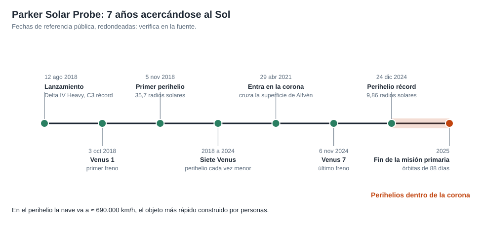

# Capítulo 5 · El perihelio

## Por qué existe este capítulo

La parte de cada órbita que justifica la misión dura **unos pocos días**, y la fase de máximo calor, **horas**. Durante ese tiempo la nave opera **sola**, sin posibilidad de ser corregida, y con la antena escondida.

*Figura 5.1.* Del lanzamiento al perihelio récord de 2024.

## La anatomía de un encuentro

Cada órbita de 88 días tiene un **tramo de ciencia** alrededor del perihelio (de unos 11 días dentro de 0,25 UA, ⚠ verifica) y un **tramo de enlace** el resto del tiempo.

| Fase | Qué ocurre |
|---|---|
| Aproximación | Se activan instrumentos y se guarda la configuración de la nave |
| Perihelio | La nave está a máxima velocidad (≈ 191 km/s), con el escudo al frente, sin enlace con la Tierra |
| Alejamiento | Se recupera el enlace y se verifica la salud |
| Descarga | Semanas de transmisión de los datos guardados |

El laboratorio (sección 5) indica que, a esa velocidad, la nave recorre un diámetro solar (≈ 1,39 millones de km) en unas **2 horas**.

## La estrategia: no mirar, apuntar al escudo

La nave **no apunta instrumentos al Sol**: apunta su escudo. Los instrumentos miden **lo que llega**: partículas y campos que pasan junto a la nave. El **sensor de imágenes** observa de lado, en el borde del escudo.

## Cuando falla la Tierra, manda la nave

Con una señal que tarda 8,3 minutos en ir a la Tierra y 8,3 en volver (16,6 min; laboratorio), un problema durante el perihelio **no se puede resolver desde tierra**: el sistema de autoprotección decide solo. Su diseño sigue tres reglas:

1. **Prioridad máxima:** mantener el escudo apuntando al Sol.
2. **Prioridad segunda:** salvar el hardware aunque se pierdan datos.
3. **Si es posible:** continuar la ciencia.

## Reglas de «ir / no ir» para cada perihelio

Antes de cada encuentro, el equipo revisa un **informe de salud** y decide si la nave está en condiciones. Si no, puede cambiar el modo (más prudente) o **ajustar la altura del perihelio** con un empujón menor. La decisión de **bajar el perihelio** en el último paso de Venus se tomó con datos de las órbitas previas.

## Qué se midió dentro de la corona

El 28 de abril de 2021 (⚠), la nave cruzó la **superficie crítica de Alfvén**, el límite que marca el final de la atmósfera solar y el comienzo del viento. Fue la primera vez que una nave **entró en la corona**. Esto prueba el criterio de éxito de la misión.

## Ejercicio del capítulo

1. Con el laboratorio, calcula el tiempo que pasa la nave dentro de 20 R☉ en una órbita con perihelio de 9,86 R☉ (aproximación de velocidad constante).
2. Diseña las **tres reglas de autoprotección** para un encuentro y explica cómo resolverías un conflicto entre ellas.
3. Escribe el **informe de salud** previo a un perihelio: diez parámetros y sus umbrales de «ir / no ir».
4. Explica por qué la nave no apunta sus instrumentos al Sol sino al lado.

Anterior: [capítulo 4](04-subsistemas.md) · Siguiente: [capítulo 6](06-operaciones-y-comunicaciones.md)
