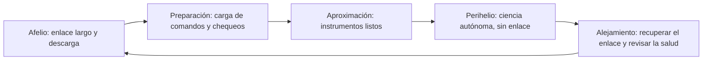

# Capítulo 6 · Operaciones y comunicaciones

## Por qué existe este capítulo

Operar una nave que se acerca al Sol significa **vivir con un enlace intermitente**: cuando más importa (en el perihelio) nadie puede comunicarse con ella. Toda la operación gira alrededor de un ciclo de 88 días.

## El ciclo de 88 días

*Descripción textual del diagrama:* en cada órbita hay un ciclo: descargar datos en el tramo lejano, preparar el siguiente encuentro, acercarse, medir sola durante el perihelio y recuperar el contacto al alejarse. Se repite cada 88 días.

## Enlace

- **Retardo de luz:** 8,3 minutos en un sentido (16,6 ida y vuelta; laboratorio, sección 5).
- **Antena detrás del escudo:** durante el perihelio no puede apuntar a la Tierra sin salirse de la sombra, así que **no hay enlace**.
- **Descarga:** el volumen de datos medido en el perihelio se **transmite en semanas**, cuando la nave está lejos del Sol y la antena puede apuntar con libertad.
- **Prioridad:** un conjunto reducido de datos «de titular» se transmite pronto; el volumen completo, después.

## Ruido solar

Cerca del Sol, el **ruido de radio** del propio Sol y de la corona puede degradar los enlaces; y la geometría Sol-Tierra-nave puede **bloquear** el enlace durante la conjunción superior. Se planifica con meses de antelación.

## Operar sin ver

Una parte inusual de esta misión: **no se puede observar** a la nave durante sus pasos de máxima aproximación. Se confía en el diseño y en los registros. El equipo **reconstruye** lo ocurrido a partir de la telemetría guardada y de los datos científicos.

## Navegación

La posición se mide con **seguimiento de radio** (distancia y velocidad) y se afina con datos de cada paso por Venus. Una **maniobra de corrección** pequeña antes de cada Venus controla la altura del paso; un error de unos cientos de metros cambia el perihelio.

## Centro de operaciones

Un equipo en el Laboratorio de Física Aplicada (Maryland), con la Red del Espacio Profundo de la NASA, y un equipo científico distribuido. Las operaciones de rutina son **repetitivas** y **muy ensayadas**; los cambios requieren una revisión formal.

## Ejercicio del capítulo

1. Diseña el **calendario de comunicaciones** de una órbita de 88 días: horas de enlace, volúmenes y prioridades.
2. Calcula la fracción de la órbita en la que la nave está a menos de 0,25 UA del Sol (aproxima con la ley de las áreas) y comenta.
3. Describe cómo **reconstruirías** un evento ocurrido sin enlace: qué datos usarías y qué incertidumbre aceptas.
4. Diseña la **planificación de la conjunción superior**: qué actividades se suspenden y por cuánto tiempo.

Anterior: [capítulo 5](05-el-perihelio.md) · Siguiente: [capítulo 7](07-fiabilidad-fallos-y-contingencias.md)
