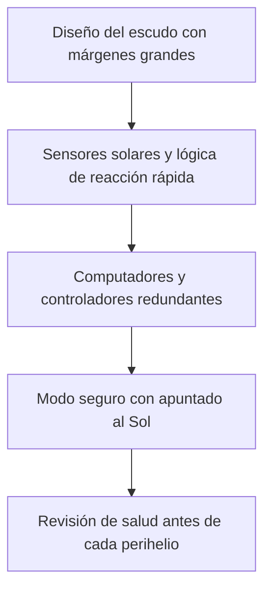

# Capítulo 7 · Fiabilidad, fallos y contingencias

## Por qué existe este capítulo

Parker enseña cómo se confía una misión a un **sistema de autoprotección**: no hay tiempo de pedir ayuda y un error de apuntado de pocos grados puede arruinar la nave. El diseño de la fiabilidad se centra en **detectar y corregir solo**.

## El sistema de autoprotección

- **Sensores solares** en el borde del escudo: detectan cuándo la luz del Sol empieza a llegar a un punto que debería estar en sombra.
- **Lógica de decisión** en computadores redundantes, con **respuesta en una fracción de segundo** (⚠ verifica el tiempo en la fuente) para devolver el escudo al Sol.
- **Escalado:** si la corrección falla, la nave pasa a un modo seguro con el escudo al frente.

**Por qué es crítico:** si el apuntado se desvía unos grados, los instrumentos y los paneles reciben hasta 650 kW/m² (laboratorio, sección 3). Un error así, sin protección, destruiría equipos en **segundos**.

## Capas de protección

*Descripción textual del diagrama:* cinco capas: un escudo con margen, sensores y lógica que reaccionan en una fracción de segundo, hardware redundante, un modo seguro que protege lo esencial y una revisión previa de cada perihelio.

## Pruebas: cómo probar algo que no existe en la Tierra

- **Pruebas del escudo** en un horno de **plasma y calor radiativo** que reproducen condiciones aproximadas de la cercanía solar, con lámparas y cámaras de alta temperatura.
- **Pruebas de los sensores y de los paneles** con **luz concentrada**.
- **Vuelos de prueba de la lógica** en simuladores con fallos introducidos.
- **Revisiones independientes** del código de autoprotección.

Pero ningún ensayo puede reproducir **todo a la vez** (flujo, velocidad, partículas, vacío). Se acepta un **riesgo residual** y se **aprende en vuelo** con perihelios progresivamente más cercanos: el **primer perihelio** fue a 35,7 R☉, más lejos, para ganar confianza.

## Aproximación gradual como método de riesgo

La misión **no** salta directo a 9,86 R☉: baja en pasos (35,7 → 27,8 → 20 → 16 → 13 → 11 → 9,86). Cada paso es una **prueba real** del diseño. Si algo sale peor de lo previsto, se puede **detener** la bajada. Es un buen ejemplo de **gestión del riesgo en etapas**.

## Fiabilidad en serie

El laboratorio (sección 6) estima, con valores ilustrativos, la probabilidad de que cinco grandes sistemas funcionen: ≈ 0,90. La misión se preparó para que **cada elemento tuviera márgenes** y para **aprender** en cada paso.

## Márgenes

- **Térmico:** el escudo soporta más de lo necesario.
- **Apuntado:** el cono de sombra deja margen angular.
- **Energía:** los paneles producen más potencia de la necesaria al ser repliegados.
- **Combustible:** pequeño pero suficiente para correcciones.

## Ejercicio del capítulo

1. Diseña un **plan de aproximación gradual** para una misión que se acerca a un cuerpo extremo: pasos, criterios de continuar o detener y reglas de decisión.
2. Calcula la probabilidad de éxito de la cadena si el sistema de autoprotección sube de 0,98 a 0,995.
3. Haz un **FMEA** de cinco filas para el sistema de apuntado del escudo.
4. Explica por qué la **autonomía** es una necesidad y no un lujo en esta misión.

Anterior: [capítulo 6](06-operaciones-y-comunicaciones.md) · Siguiente: [capítulo 8](08-seguridad-y-proteccion.md)
