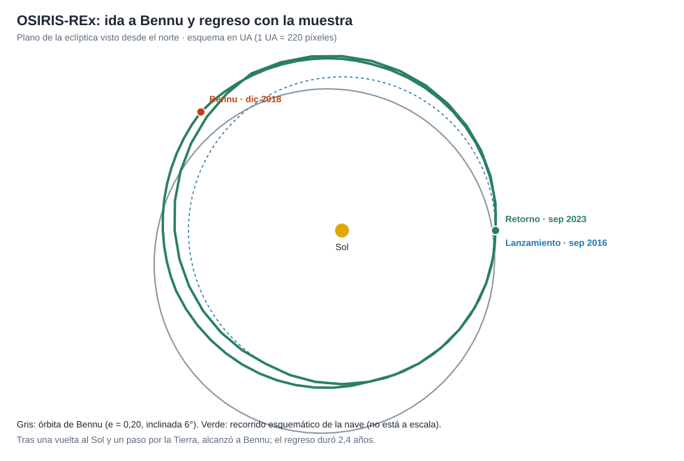

# Capítulo 2 · Ventana y trayectoria

## Por qué existe este capítulo

Bennu pasa muy cerca de la Tierra, así que parece fácil. Pero el cuerpo tiene una **órbita inclinada** respecto a la nuestra y **elíptica**, y eso encarece el viaje mucho más que la distancia. Este capítulo explica la trampa y cómo se resolvió.

*Figura 2.1.* Esquema en UA. Generado por [`figuras_T08.py`](figuras_T08.py).

## La trampa de la inclinación

El laboratorio (sección 2):

| Magnitud | Valor |
|---|---|
| v∞ de una transferencia ideal (circular y coplanar) a 1,126 UA | ≈ 0,87 km/s |
| Cambio de plano de 6° a 29,8 km/s | ≈ 3,13 km/s |
| C3 real del lanzamiento (⚠) | ≈ 28 km²/s² |

**Lo que muestra:** casi todo el costo de energía viene de **girar el plano de la órbita**, no de la distancia. La órbita de Bennu está inclinada ≈ 6° respecto a la eclíptica; cambiarla a la velocidad de la Tierra cuesta tres veces más que el desplazamiento radial. Hay que **ir al nodo** (el punto en que ambas órbitas se cruzan) o **gastar energía**.

## La solución: una vuelta y un paso por la Tierra

En lugar de gastar combustible para girar el plano, la misión:

1. **Se lanzó** el 8 de septiembre de 2016 con un cohete Atlas V (C3 ≈ 28 km²/s², ⚠).
2. **Dio una vuelta al Sol** en una órbita casi igual a la de la Tierra.
3. **Volvió a pasar por la Tierra** el 22 de septiembre de 2017 y usó su gravedad para **girar el plano** y ajustar la órbita: una **asistencia gravitatoria**.
4. **Llegó a Bennu** el 3 de diciembre de 2018.

**Lección:** una asistencia sirve para **girar un plano**, no solo para ganar velocidad (T05 y T07).

## La ventana

La ventana de lanzamiento fue de **veinte días** (septiembre de 2016), con una hora precisa cada día (⚠). Si se perdía, el **siguiente año** habría exigido otra trayectoria, con llegada años más tarde. Se programaron **días de reserva** y un **cohete preparado**.

## El regreso

Tras la toma de muestra, la nave debía **esperar una ventana de salida**: Bennu y la Tierra deben estar bien colocadas para ahorrar energía. Salió el **10 de mayo de 2021** y volvió en **2,4 años**, hasta entregar la cápsula el 24 de septiembre de 2023. El laboratorio (sección 5) da la v∞ de llegada: ≈ 5,6 km/s.

## Sistema de referencia y tiempo

Heliocéntrico para el traslado y asteroidocéntrico para el trabajo cerca de Bennu; geocéntrico para el regreso. **Fechas en UTC.**

## Ejercicio del capítulo

1. Calcula el costo de un cambio de plano de 4° y de 10° a la velocidad de la Tierra. ¿Para qué inclinaciones sale más barato un asteroide lejano pero coplanar?
2. Explica con un esquema por qué un cambio de plano se hace **mejor en el nodo** y a baja velocidad.
3. Diseña una **ventana de salida** de un asteroide con tres criterios: energía, comunicaciones y seguridad de la cápsula.

Anterior: [capítulo 1](01-objetivo-y-requisitos.md) · Siguiente: [capítulo 3](03-lanzador-masas-y-vehiculo.md)
