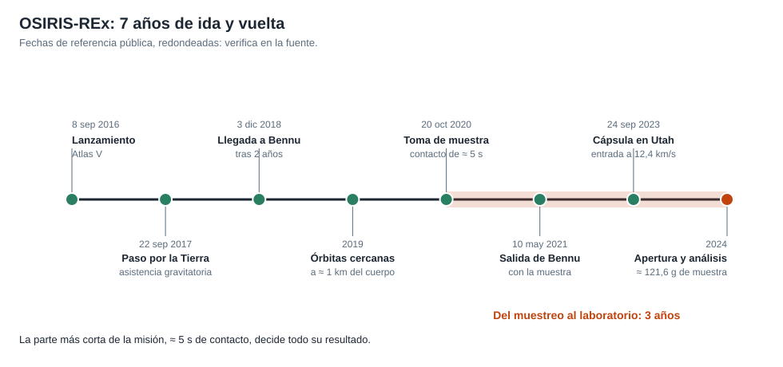
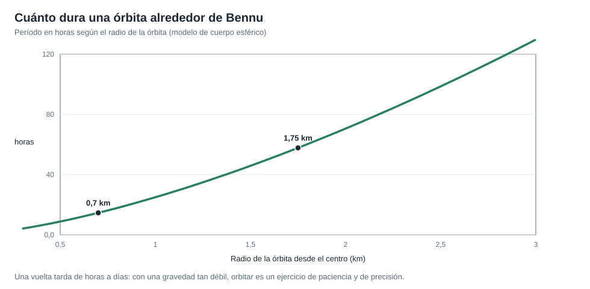

# Capítulo 5 · Cerca del cuerpo y toma de muestra

## Por qué existe este capítulo

Dos retos distintos: **orbitar** un cuerpo cuya gravedad es una millonésima de la terrestre y **tocarlo** durante cinco segundos. Ambos se resuelven con precisión y con tiempo.

*Figura 5.1.* Del lanzamiento a la apertura de la muestra.

## Un cuerpo diminuto

El laboratorio (sección 1) calcula, con un modelo esférico de 245 m de radio y GM = 4,892 m³/s²:

| Magnitud | Valor |
|---|---|
| Gravedad en la superficie | ≈ 8 cienmilésimas de m/s² (≈ 8 millonésimas de la terrestre) |
| Velocidad de escape | ≈ 20 cm/s |
| Velocidad en una órbita a 1 km | ≈ 7 cm/s, con período de ≈ 25 horas |

**Consecuencia:** una nave a pocos cm/s sobre el cuerpo **orbita**; a 20 cm/s **escapa**. Un empujón de un propulsor puede ser demasiado.

*Figura 5.2.* Período en horas según el radio de la órbita.

## Órbitas cercanas

La nave no «aparcó» sino que describió **órbitas controladas** a menos de 1 km del centro, con períodos de unas horas a días (≈ 15 horas a 0,7 km). Un detalle sorprendente: al poco de llegar, el asteroide **lanzó pequeñas partículas** al espacio y algunas orbitaron brevemente a su alrededor. Hubo que estudiar ese comportamiento, porque podría dañar la nave y afectar la navegación (capítulo 7).

## La toma de muestra (TAG)

El **20 de octubre de 2020**, la nave hizo su ensayo final y **tocó** el sitio elegido (llamado Nightingale):

1. **Salida de la órbita** y descenso de unas 4,5 horas.
2. **Punto de control** y **punto de coincidencia** (con la velocidad ajustada a la del cuerpo), a unas decenas de metros.
3. **Contacto** a ≈ 10 cm/s, con el brazo extendido y el chorro de gas durante unos **5 segundos**.
4. **Retirada** y verificación de la masa recogida.

El laboratorio (sección 4) subraya la cifra clave: el retardo de comunicación (18,5 minutos) es **222 veces** mayor que el contacto (5 s). **Nadie puede intervenir.**

## El resultado

Se recogieron unos **121,6 gramos** (⚠), el **doble** del requisito de 60 g. Tan bien salió que, al intentar almacenarla, se vio que **algunas partículas escapaban** del cabezal por una tapa que no cerró bien. Se decidió **guardar la muestra de inmediato**, sin hacer una medición de masa extra.

**Lección:** un resultado mejor de lo esperado puede traer **problemas nuevos** y exige un plan de contingencia para el éxito.

## Planes alternativos

El diseño permitía **hasta tres intentos** (tres botellas de gas) y había **sitios de reserva** elegidos. El segundo sitio principal se tuvo en cuenta durante años. Esta **redundancia de oportunidad** fue una pieza central del plan.

## Ejercicio del capítulo

1. Con el laboratorio, calcula la velocidad y el período de una órbita a 500 m y a 2 km del centro. ¿A qué radio pondrías una órbita de observación y por qué?
2. Diseña la **secuencia de descenso** del muestreo con cuatro puntos de control y su criterio de abortar.
3. Calcula el tiempo de un descenso desde 125 m hasta el contacto a 10 cm/s (aproximación de velocidad constante).
4. Define qué harías si el resultado fuese **diez veces mejor** de lo esperado.

Anterior: [capítulo 4](04-subsistemas.md) · Siguiente: [capítulo 6](06-operaciones-y-comunicaciones.md)
