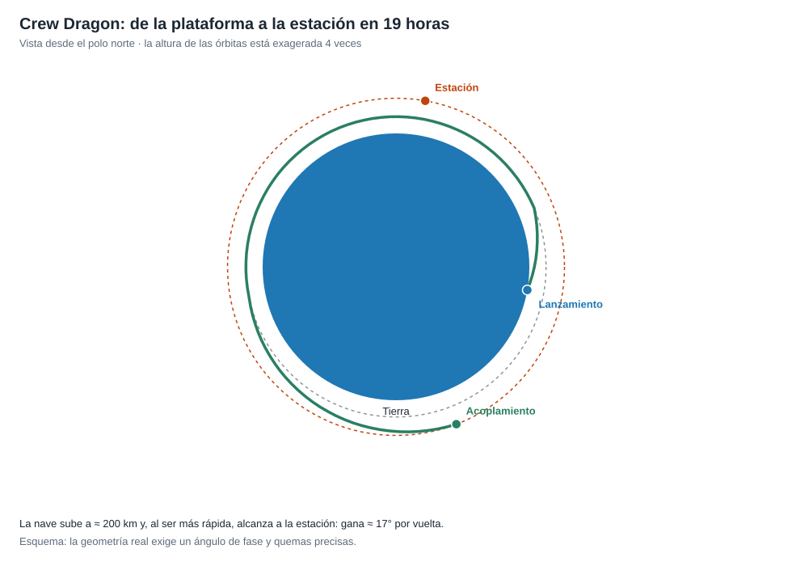

# Capítulo 2 · Ventana y trayectoria

## Por qué existe este capítulo

La estación orbita a ≈ 420 km y a 7,66 km/s. Llegar a ella no es subir: es **alcanzar a un objeto que ya se mueve**, con la misma velocidad y en el mismo plano. Eso fija la ventana y la forma del viaje.

*Figura 2.1.* Esquema con la altura exagerada. Generado por [`figuras_T09.py`](figuras_T09.py).

## La órbita de destino

El laboratorio (sección 1):

| Magnitud | Valor |
|---|---|
| Altura | ≈ 420 km |
| Velocidad orbital | ≈ 7,66 km/s |
| Período | ≈ 93 min (≈ 15,5 vueltas al día) |
| Inclinación | 51,6° |
| Azimut de lanzamiento desde 28,5° de latitud | ≈ 45° (hacia el noreste) |

La inclinación de 51,6° de la estación se eligió para que sea **accesible desde Rusia y desde Estados Unidos**. Lanzar al noreste desde Florida da la inclinación deseada y aprovecha **≈ 290 m/s** de la rotación terrestre.

## Una ventana instantánea

Para alcanzar la estación hay que lanzar **cuando su plano orbital pasa sobre la plataforma**. Eso ocurre dos veces al día, y la ventana útil es de **un instante** (segundos). Si se pierde, se espera 24 horas (o, para cumplir otros requisitos, otro día). La ventana también depende de **iluminación**, de **meteorología** en el lanzamiento, en el recorrido de aborto y en la zona de amerizaje.

## Alcanzar la estación (fases de la ruta)

1. **Inserción** en una órbita baja (≈ 200 km), unos 12 minutos tras el despegue.
2. **Fase de alcance:** la cápsula, en una órbita más baja, completa vueltas **más rápido** que la estación y le gana terreno. El laboratorio (sección 2) calcula ≈ 17° por vuelta (88,5 min frente a 93 min).
3. **Quemas de ajuste** que elevan la órbita hasta la de la estación (≈ 127 m/s en total para pasar de 200 a 420 km).
4. **Aproximación** y **acoplamiento**, a unos 10 cm/s en la fase final.

La misión real tardó **≈ 19 horas**: cerrar un ángulo de fase de 180° a 270° exige entre 10 y 16 vueltas (laboratorio). Es una elección de diseño: **más tiempo** significa **más margen** para verificar los sistemas con la tripulación a bordo; **menos tiempo** (algunas misiones rusas lo hacen en 3 horas) exige una geometría más exigente.

## Sistema de referencia y tiempo

Geocéntrico inercial para la ruta; **hora en UTC**. Las horas de la ventana (el lanzamiento fue a las 19:22 UTC, ⚠) se declaran siempre con su zona.

## Ejercicio del capítulo

1. Calcula con el laboratorio el azimut de lanzamiento para una inclinación de 28,5° y de 97° desde la misma latitud. ¿Qué sentido tiene cada una?
2. Calcula el delta-v de las dos quemas para llegar desde 250 km hasta 420 km.
3. Diseña la **ventana de lanzamiento**: criterios, tiempos y plan si se pierde.
4. Explica por qué la nave **baja** y luego sube para alcanzar a la estación.

Anterior: [capítulo 1](01-objetivo-y-requisitos.md) · Siguiente: [capítulo 3](03-lanzador-masas-y-vehiculo.md)
