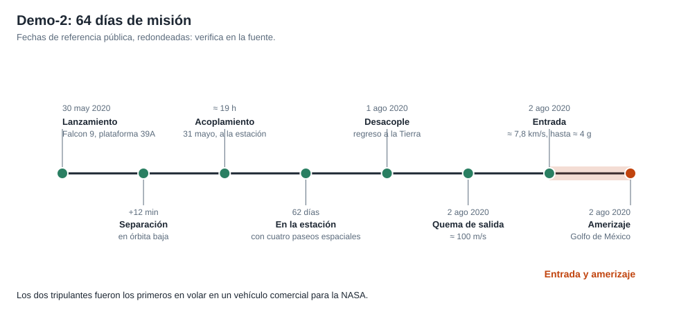

# Capítulo 5 · Abortos, acoplamiento y retorno

## Por qué existe este capítulo

Tres fases concentran el riesgo del vuelo: el **ascenso** (con la posibilidad de abortar), el **acoplamiento** (con una estación habitada) y el **retorno** (reentrada y amerizaje). En cada una hay un modo seguro y un plan de emergencia.

*Figura 5.1.* De la plataforma al amerizaje.

## Ascenso y abortos

El ascenso dura ≈ 12 minutos. Un cohete puede fallar en cualquier segundo; el sistema de aborto debe **separar la cápsula** y llevarla a un lugar seguro:

- **En la plataforma:** los SuperDraco elevan la cápsula lejos del cohete y la dejan caer con paracaídas.
- **A lo largo del ascenso:** la cápsula se separa y se aleja del cohete en llamas.
- **Cerca del punto de máxima presión dinámica** (alrededor de 1 minuto y 10 segundos después del despegue): el momento más exigente para el cohete y para el aborto.
- **Casi en órbita:** el aborto es un descenso con otro perfil.

El laboratorio (sección 3) calcula la aceleración: con **8 motores de ≈ 71 kN** y una cápsula de 9 a 12 t, la relación empuje/peso es de 4,8 a 6,4 (aceleración neta ≈ 4 a 5 g). Un aborto es **violento** pero sobrevivible; hay trajes y asientos diseñados para ello.

### La prueba de aborto en vuelo

En enero de 2020 se probó el aborto con una cápsula sin personas: el cohete **se dejó caer** al apagar los motores en el momento de máxima presión; la cápsula se separó y amerizó con paracaídas. Es una prueba «prueba como vuelas»: se provoca el escenario más difícil.

## Acoplamiento

La aproximación se hace por un **corredor** con puntos de comprobación (por ejemplo a 400 m, 200 m, 20 m), a velocidades de **≈ 10 cm/s** en la fase final. El software lo hace de forma autónoma; los astronautas lo supervisan y pueden **detener** o tomar el mando manual. Se acopla a un **puerto** de la estación diseñado para ello. Tras el acoplamiento hay **comprobaciones de estanqueidad** antes de abrir la escotilla.

**Riesgo específico:** una colisión con la estación **pone en peligro a siete personas** que no están en la cápsula. Por eso hay **reglas de aborto** de la aproximación y trayectorias de escape pasivamente seguras.

## Retorno

1. **Desacople** y alejamiento de la estación.
2. **Quema de desorbitación** de ≈ 100 m/s (laboratorio, sección 4) para bajar el perigeo a ≈ 50 km.
3. **Separación del maletero** y orientación del escudo térmico.
4. **Entrada** a ≈ 7,8 km/s (≈ 31 MJ/kg, la mitad que desde la Luna) con una deceleración de ≈ 4 g.
5. **Paracaídas** en dos etapas y **amerizaje** (≈ 20 a 25 km/h al tocar el agua; ⚠ verifica).
6. **Recuperación** por un buque y un equipo con médicos en pocos minutos.

La decisión de **amerizar** en lugar de aterrizar en tierra se tomó por razones de seguridad y de simplicidad; exige **buen tiempo** en la zona (viento, olas, tormentas), con **zonas alternativas** a ambos lados de Estados Unidos.

## Qué podría fallar

| Evento | Qué podría fallar | Mitigación |
|---|---|---|
| Ascenso | Fallo del cohete | Sistema de aborto probado en plataforma y en vuelo |
| Acoplamiento | Error de navegación relativa | Sensores redundantes, aborto y modo manual |
| Desorbitación | Quema incompleta | Propulsores redundantes y reintento |
| Entrada | Daño del escudo, ángulo erróneo | Escudo ablativo, corredor estrecho, redundancia |
| Paracaídas | Falla de apertura | Redundancia: sobrevive con uno menos |
| Amerizaje | Clima adverso | Ventana de regreso y zonas alternativas |

## Ejercicio del capítulo

1. Con el laboratorio, calcula la aceleración de aborto para 4 personas y 13 t con 8 motores de 80 kN. ¿Qué cambia respecto al caso real?
2. Diseña el **corredor de aproximación** con tres puntos de comprobación y su regla de «ir / no ir».
3. Elige un **plan de recuperación** con zonas alternativas y criterios meteorológicos.
4. Explica por qué la reentrada desde órbita baja es menos exigente que desde la Luna y qué sigue siendo difícil.

Anterior: [capítulo 4](04-subsistemas.md) · Siguiente: [capítulo 6](06-operaciones-y-comunicaciones.md)
