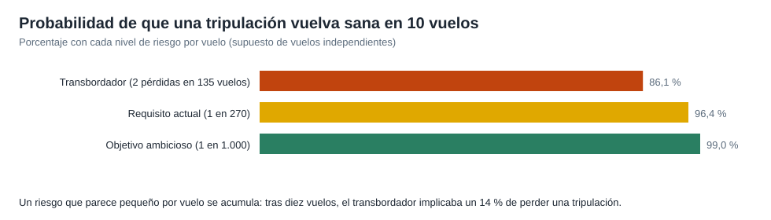
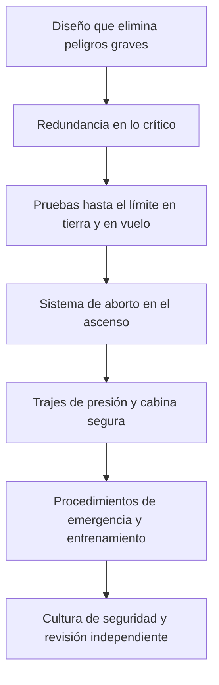

# Capítulo 7 · Fiabilidad, fallos y contingencias

## Por qué existe este capítulo

En vuelo tripulado, la fiabilidad se mide con un número: la **probabilidad de pérdida de la tripulación (LOC)**. Este capítulo explica cómo se interpreta, cómo se acumula y qué historia de accidentes dio forma a las reglas.

## Un historial que obliga

Los accidentes del **Apollo 1** (1967), del **Challenger** (1986) y del **Columbia** (2003) dieron lugar a investigaciones públicas con conclusiones que **cambiaron la cultura de seguridad**:

- **Cultura:** reconocer que «normalizar la desviación» (aceptar un problema repetido porque no ha causado accidente) es un riesgo.
- **Análisis independiente:** equipos de seguridad con autonomía respecto del proyecto.
- **Comunicación:** que cualquier ingeniero pueda detener un lanzamiento.

(⚠ contrasta los detalles con los informes oficiales de cada investigación).

## LOC: cómo se calcula y qué significa

La NASA fija un **requisito** de LOC máximo por misión (≈ 1 en 270 para las misiones a la estación; ⚠ verifica el valor vigente). Se calcula con un **análisis de riesgo probabilista**: cada fallo posible, su probabilidad y su efecto, combinados en árboles de fallas.

El laboratorio (sección 6) compara:

| Nivel de riesgo por vuelo | Probabilidad de volver sano en 10 vuelos |
|---|---|
| Transbordador: 2 pérdidas en 135 vuelos (≈ 1 en 68) | ≈ 86 % |
| Requisito actual: 1 en 270 | ≈ 96 % |
| Objetivo ambicioso: 1 en 1.000 | ≈ 99 % |

*Figura 7.1.* Un riesgo pequeño por vuelo se acumula.

**Lectura:** el requisito no es «cero»: es un número que la sociedad y la agencia aceptan a cambio de explorar. Debe ser **explícito y público**, y se **actualiza** con los datos de cada vuelo.

## Capas de protección

*Descripción textual del diagrama:* siete capas: eliminar el peligro por diseño, duplicar lo crítico, probar, abortar si el cohete falla, proteger a la tripulación con el traje y la cabina, entrenar para las emergencias y mantener una cultura y una revisión que no oculten problemas.

## Certificación

Para certificar el vehículo, la agencia exige **evidencia** de cada requisito: pruebas de componentes y de sistema, análisis, inspección y demostraciones. Se revisan en **hitos formales** (diseño, pruebas, preparación del vuelo) con un comité independiente. Las **observaciones abiertas** se cierran antes de volar.

## Contingencias a bordo

- **Despresurización de la cabina:** los trajes y el procedimiento de emergencia.
- **Fuego o humo:** detección, procedimientos y equipos de protección.
- **Fallo de un sistema de propulsión o de control:** modos degradados y retorno.
- **Emergencia médica:** protocolos con médicos en tierra.
- **Evacuación de la estación:** salida inmediata en la cápsula.

Cada contingencia tiene un **procedimiento** ensayado en simuladores con **fallos introducidos** por los instructores.

## Ejercicio del capítulo

1. Calcula con el laboratorio la probabilidad de volver sano en 20 vuelos con riesgos de 1 en 100, 1 en 270 y 1 en 1.000.
2. Construye un **árbol de fallas** de «pérdida de la tripulación en el ascenso» hasta tres niveles.
3. Escribe el **procedimiento de emergencia** de una despresurización con cinco pasos.
4. Explica con tus palabras qué es «normalizar la desviación» y cómo la evitarías.

Anterior: [capítulo 6](06-operaciones-y-comunicaciones.md) · Siguiente: [capítulo 8](08-seguridad-y-salud.md)
