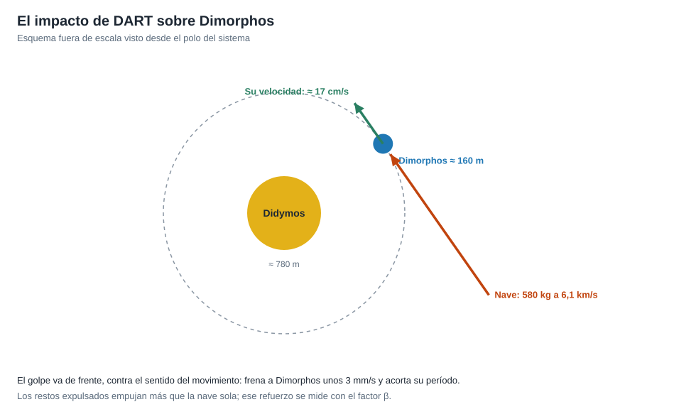

# Capítulo 2 · Ventana y trayectoria

## Por qué existe este capítulo

La nave debía llegar a Dimorphos **a 6,1 km/s**, con un ángulo y un momento precisos, cuando el sistema estuviera **cerca de la Tierra** (≈ 11 millones de km) para poder observar el resultado con telescopios. Eso fija la ventana, la trayectoria y la geometría del choque.

*Figura 2.1.* Esquema fuera de escala. Generado por [`figuras_T10.py`](figuras_T10.py).

## El sistema

El laboratorio (sección 1) calcula con las masas de referencia (⚠):

| Magnitud | Valor |
|---|---|
| Didymos | ≈ 780 m de diámetro, ≈ 5·10¹¹ kg |
| Dimorphos | ≈ 160 m de diámetro, ≈ 4·10⁹ kg |
| Semieje de la órbita de Dimorphos | ≈ 1,2 km |
| Período | ≈ 11,9 h |
| Velocidad orbital de Dimorphos | ≈ 17 cm/s |

## La ventana: cuando el sistema está cerca de la Tierra

El sistema Didymos pasa cerca de la Tierra cada pocos años. La fecha del impacto (**26 de septiembre de 2022**) se eligió para que:

- La **distancia** a la Tierra fuera de ≈ 11 millones de km (≈ 37 s de luz, laboratorio, sección 4).
- Los **telescopios** pudieran observar el sistema (luz de fondo, fase y visibilidad desde ambos hemisferios).
- El **ángulo** de aproximación fuera el adecuado respecto al sol y al plano orbital.

El **lanzamiento** fue el 24 de noviembre de 2021 desde Vandenberg (California), un viaje de **10 meses** sin asistencias gravitatorias.

## La geometría del impacto

El golpe **de frente** (contra el sentido del movimiento) es el más eficaz para **frenar** a Dimorphos y acortar su período. El laboratorio (sección 3) da el cálculo:

- Cantidad de movimiento de la nave: ≈ 3,5·10⁶ kg·m/s.
- Con β = 1 (solo la nave), el cambio de velocidad de Dimorphos es ≈ 0,8 mm/s.
- Con β = 3,6, ≈ 3 mm/s.

## Sistema de referencia y tiempo

Dimorphos respecto a Didymos (órbita casi circular y en un plano); el impacto en un instante conocido en **UTC** (23:14 UTC, ⚠ verifica). La nave llegó al sistema desde un ángulo respecto a la dirección del Sol que permitía iluminar el blanco.

## Ejercicio del capítulo

1. Calcula la velocidad de impacto necesaria para producir un cambio de 3 mm/s con una nave de 500 kg y β = 3 sobre un cuerpo de 4·10⁹ kg.
2. Explica por qué un impacto de **frente** es más eficaz que uno **lateral** para cambiar el período.
3. Diseña los **criterios de elección de la fecha** del impacto: distancia, visibilidad, geometría y alternativas.

Anterior: [capítulo 1](01-objetivo-y-requisitos.md) · Siguiente: [capítulo 3](03-lanzador-masas-y-vehiculo.md)
