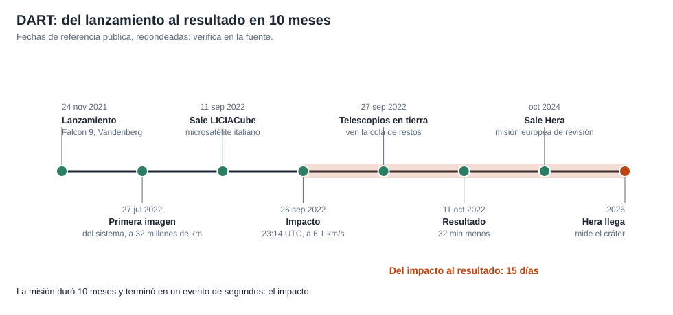

# Capítulo 5 · Los últimos minutos

## Por qué existe este capítulo

Diez meses de viaje para unos **minutos** de misión real. En ese tiempo la nave tuvo que **encontrar**, **distinguir** y **acertar** a un objeto de 160 m a una velocidad de 6,1 km/s, sin ayuda.

*Figura 5.1.* Del lanzamiento al resultado, y la misión de seguimiento.

## La secuencia terminal (⚠ tiempos redondeados)

| Tiempo antes del impacto | Qué ocurre |
|---|---|
| Semanas | Primera imagen del sistema a decenas de millones de km (27 de julio de 2022) |
| Días | Se afina la trayectoria con la Tierra; se entrega el microsatélite 15 días antes |
| ≈ 4 horas | Comienza el modo autónomo, con el guiado a bordo |
| ≈ 1 hora | Dimorphos aparece separado de Didymos (como un punto aparte) |
| ≈ 2 minutos | Última corrección; después, solo apunta |
| ≈ 20 segundos | Las imágenes muestran el terreno: rocas y la superficie |
| 0 | Impacto a ≈ 6,1 km/s |

El laboratorio (sección 4): en la última hora la nave recorre ≈ 22.000 km; en los últimos 4 minutos, ≈ 1.460 km; en los últimos 20 segundos, ≈ 120 km.

## El reto: encontrar al «pequeño»

Al principio, Didymos y Dimorphos son un **único punto** de luz. Dimorphos aparece como un objeto separado solo **una hora antes**. La nave debía **decidir en ese momento** a cuál de los dos apuntar, y hacerlo antes de que fuera demasiado tarde para corregir. Con el blanco equivocado (Didymos, 5 veces mayor), la misión habría perdido su sentido científico.

## Lo que vio la cámara

Las últimas imágenes muestran un terreno lleno de **rocas** y sin cráteres evidentes: un cuerpo tipo «pila de escombros», con la superficie **suelta**. Esto importa: el efecto del impacto depende de la **estructura** del cuerpo (un cuerpo suelto expulsa más material y su β es mayor).

## El microsatélite

Quince días antes del impacto, la nave soltó a **LICIACube**, un cubo de ≈ 14 kg de la agencia espacial italiana. Pasó a ≈ 55 km de Dimorphos unos minutos después del impacto y **fotografió** la nube de restos y el cráter. Sin esos datos, **no se habría visto el efecto inmediato**.

## Qué podía salir mal

| Evento | Qué podía fallar | Mitigación |
|---|---|---|
| Distinguir los objetos | Elegir Didymos | Reglas de decisión robustas y ensayo con simulaciones |
| Corrección tardía | Error de apuntado de decenas de metros | Corrección continua hasta 2 minutos antes |
| Imagen saturada | Brillo de Didymos oculta a Dimorphos | Exposición adaptativa de la cámara |
| Fallo de un computador | Pérdida de guiado | Redundancia y reinicio rápido |
| Un obstáculo (roca) en la trayectoria | Un impacto en un punto no previsto | Se aceptó: el efecto es robusto a pequeñas variaciones |

## Ejercicio del capítulo

1. Con el laboratorio, calcula cuántos píxeles ocupa Dimorphos (160 m) a 400 km, 40 km y 4 km con un campo de visión de 0,29° y 2048 píxeles.
2. Diseña una **regla de decisión** para elegir el blanco con tres condiciones y la probabilidad de error.
3. Escribe el **plan de contingencia** para un fallo del computador a 30 minutos del impacto.
4. Explica por qué el equipo **aceptó** que el punto exacto del impacto variara unos metros.

Anterior: [capítulo 4](04-subsistemas.md) · Siguiente: [capítulo 6](06-operaciones-y-observacion.md)
