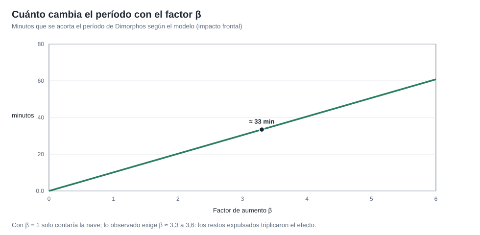

# Capítulo 6 · Operaciones y observación

## Por qué existe este capítulo

El impacto dura un instante; **el resultado se mide semanas**. La parte científica de DART es una campaña de observación mundial que convierte un cráter y una nube de polvo en un número: **cuántos minutos cambió el período**.

## Cómo se mide el período

Didymos y Dimorphos están demasiado cerca para separarlos en un telescopio. Lo que se observa es la **luz combinada**, que baja un poco cada vez que Dimorphos **pasa por delante** de Didymos (un tránsito) o **por detrás** (un eclipse). La **curva de luz** muestra esos pequeños bajones. Si el período cambia, los bajones **se adelantan** semana tras semana.

- Antes del impacto: un período de ≈ **11 h 55 min**.
- Después: ≈ **11 h 23 min**; el cambio, ≈ **32 minutos** (con una incertidumbre de pocos minutos; ⚠ verifica en el informe).

El laboratorio (sección 3) conecta ambos: un cambio de velocidad de ≈ 3 mm/s produce un acortamiento de ≈ 33 a 36 minutos, del mismo orden que lo medido.

*Figura 6.1.* El modelo y la medición se reúnen en β ≈ 3,3 a 3,6.

## La campaña de observación

- **Telescopios** de todo el mundo: observatorios profesionales y redes de aficionados, coordinados para no dejar huecos por la rotación de la Tierra.
- **Radar** de las antenas del Espacio Profundo y de grandes radiotelescopios.
- **Telescopio espacial** para ver la nube de restos y su evolución.
- **Imágenes de LICIACube**, que dieron la forma y el tamaño de la nube de restos.

Se publicó una **cola de polvo** de miles de kilómetros que duró semanas: un resultado inesperadamente espectacular.

## Comunicaciones y datos

- **Retardo de luz** de ≈ 37 s en el impacto (laboratorio, sección 4).
- **Datos de la nave** hasta el último instante posible; el microsatélite los envió **después** (más lento).
- **Archivo público:** los datos se publican con un calendario; la medida independiente por varios grupos refuerza la **credibilidad**.

## La misión de seguimiento

La misión europea **Hera** (lanzada en octubre de 2024 y con llegada prevista a finales de 2026; ⚠ verifica) irá al sistema para **medir** el cráter, la masa de Dimorphos y su estructura interna. Con eso se podrá **convertir** la medición de β en un valor con incertidumbre menor y entender el resultado. Es parte del diseño: **una prueba sin seguimiento es media prueba**.

## Ejercicio del capítulo

1. Diseña una **campaña de observación** con cinco telescopios en distintas longitudes para cubrir 24 horas: ¿qué huecos quedan?
2. Con el laboratorio, calcula cuántos minutos se adelanta un tránsito después de 10 días si el período se acorta 32 minutos.
3. Redacta el **plan de datos abiertos** de la campaña: qué se publica, cuándo y con qué verificación independiente.
4. Explica con tus palabras por qué la masa de Dimorphos es esencial para calcular β.

Anterior: [capítulo 5](05-los-ultimos-minutos.md) · Siguiente: [capítulo 7](07-fiabilidad-fallos-y-contingencias.md)
