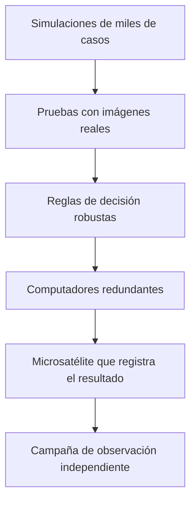

# Capítulo 7 · Fiabilidad, fallos y contingencias

## Por qué existe este capítulo

DART no tenía una segunda oportunidad: la nave se destruye. La fiabilidad aquí significa **que el único intento funcione** y, a la vez, **que los datos del intento permitan aprender** aunque algo no salga como se esperaba.

## La cadena de eventos

El laboratorio (sección 6) calcula, con valores ilustrativos, la probabilidad de que los seis grandes eventos salgan bien: lanzamiento, crucero, detección, separación del microsatélite, navegación terminal e impacto en un blanco de 160 m. Resultado: ≈ **0,76**. El eslabón más débil es la **navegación terminal** y la puntería final.

## Cómo se reduce el riesgo de la navegación terminal

1. **Pruebas con simulaciones** de miles de trayectorias con errores aleatorios en sensores y dinámicas.
2. **Ensayo con imágenes** reales: la cámara y el software se probaron con un cielo real y un blanco simulado.
3. **Reglas de decisión robustas:** si dos candidatos son parecidos, el software elige por criterios previamente definidos.
4. **Aprobación independiente** del código de guiado.
5. **Datos del viaje:** en el crucero, la nave **practicó** con otros cuerpos.

## Fallos que se asumen

- Una **roca** puede desviar ligeramente el punto de impacto: no se evita (el efecto es robusto).
- Una **imagen saturada** puede retrasar una corrección: se compensa con exposición adaptativa.

## Capas de protección

*Descripción textual del diagrama:* seis capas de confianza: simulación, ensayo con imágenes reales, reglas robustas, hardware redundante, un testigo (el microsatélite) y una medición independiente desde tierra que no depende de la nave.

## La confianza en el resultado

Un resultado científico necesita **más de una vía de verificación**: DART tuvo **tres**: las imágenes de la propia nave, las del microsatélite y las observaciones de tierra. **Credibilidad = redundancia de evidencias.**

## Contingencias

- **Si el impacto falla:** la medición del período seguiría disponible solo si el choque ocurre; si la nave pasa de largo, la misión no cumple. No hay plan B posible: se asumió por diseño.
- **Si la medición es ambigua:** se repite la campaña y se espera a la misión de seguimiento.
- **Si el resultado es mejor de lo esperado:** hay que **explicar** por qué (β alto), sin exagerar la eficacia de la técnica para casos reales.

## Ejercicio del capítulo

1. Calcula la probabilidad de éxito de la cadena si la navegación terminal sube de 0,93 a 0,98.
2. Diseña una **estrategia de verificación** de un resultado científico con tres fuentes independientes.
3. Haz un **FMEA** de cinco filas para la navegación terminal.
4. Explica cómo comunicarías un resultado **mejor de lo esperado** sin exagerar.

Anterior: [capítulo 6](06-operaciones-y-observacion.md) · Siguiente: [capítulo 8](08-seguridad-y-etica.md)
